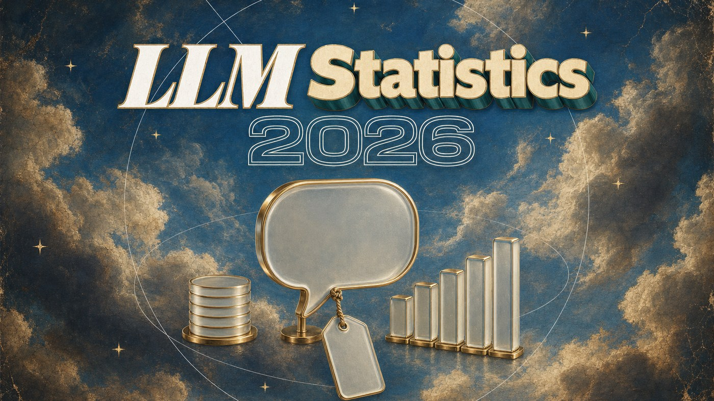
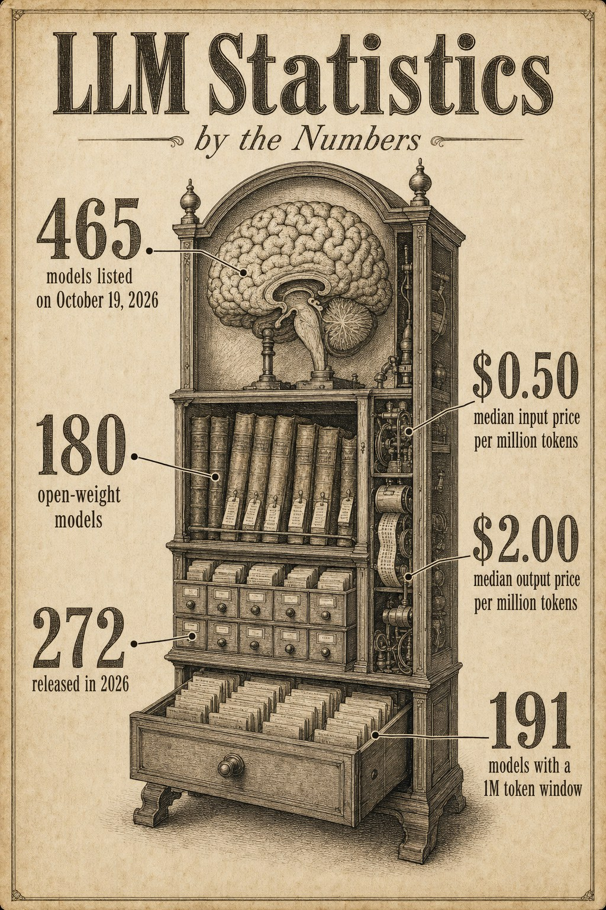
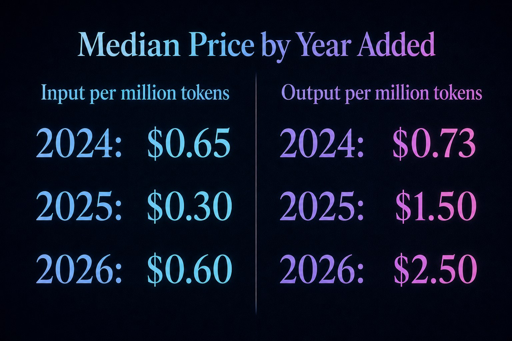

I noticed on r/technology on the 30th of Sep. 2026  a post which stated that the price of ai is crashing quicker than Moore's Law rate.  as of the 17th Nov. it has approx. 2,170 up votes and 645 comments.

A headline like that is easy to repeat and hard to test. So on October 19, 2026, the team at [RankControl, an AI SEO and AEO platform](https://rctrl.com), where I work, downloaded OpenRouter's public list of models and counted it.

OpenRouter directs developer traffic to hundreds of LLMs (large language models, like ChatGPT, Claude, Gemini)

LLM statistics for 2026 were originally published by RankControl on Oct 22, 2026, as [LLM Statistics 2026](https://rctrl.com/blog/llm-statistics-2026).
I re-opened all sources and repeated the pull for the catalog on Nov 17, 2026. The following figures are flagged if they changed since.

TL;DR: On October 19, OpenRouter had 465 models. The median price was $0.50/mm input tokens, $2.00/mm output tokens. (A token is a tiny chunk of text, and a million tokens is about 750k words.) 2026 models had a higher median price than 2025 models.

## How we checked

**What we counted.** RankControl got OpenRouter's list of public models via API on October 19, 2026, and then filtered out OpenRouter's own routing entries for a total of 465 models. The "year" for a model release is the year the model was added to the catalog.

**Definitions.** We consider a model open-weight (i.e. downloadable/runnable by anyone) if it has a published Hugging Face ID (the main website to share model files). Prices are OpenRouter's listed prices, which may vary a bit from the model maker's direct prices.

**Usage and user numbers.** The weekly usage is taken from [OpenRouter's rankings page](https://openrouter.ai/rankings). (They share their data under CC BY 4.0.) User and survey data comes from the indicated publishers, dated as in the text.

**My check on October 19.** The Internet Archive (Archive from here on) has cached [OpenRouter's API response](https://openrouter.ai/api/v1/models) on October 19, 2026 at 08:23 UTC. There are 471 items there. If we remove 6 that have IDs starting with "openrouter/", we're left with 465 exactly.

Okay so counting that copy reproduces RankControl's numbers (models added in 2026 (272), windows in millions of tokens (191), open weight models (180), tool calling (396), reasoning (337), text only models (146), free models (18).

Same median prices. Except that those only match if you exclude free models (which I'm taking as medians of paid models).

It didn't copy everything. There's 66 makers (with aliases prefixes), the maker table needs 1 extra rule. The median output price for open-weight was $0.65 instead of $0.60 and there was a different price for DeepSeek V4.1 Flash. This is highlighted whenever it occurs.

**My re-check on November 17.** I just called the API again using the same rules. 470 entries, 463 after removing the 7 "openrouter/" entries.

**Limits.** Remember, this is one moment for one catalog. Many versions/variations make them distinct models, prices vary, and OpenRouter usage only reflects what transits through OpenRouter. I'm using my interpretation of API fields for my counts in tool calling, reasoning and text only.

## The numbers at a glance

| Measure | Figure | Publisher and date |
|---|---|---|
| Models in OpenRouter's catalog | 465 | OpenRouter, pulled October 19, 2026 (463 on November 17) |
| Makers of those models | 58 | OpenRouter, October 19, 2026 (RankControl's page says 66; 60 on November 17) |
| Models added in 2026 | 272 | OpenRouter, October 19, 2026 (301 on November 17) |
| Median price per million input tokens | $0.50 | OpenRouter, October 19, 2026 ($0.50 on November 17) |
| Median price per million output tokens | $2.00 | OpenRouter, October 19, 2026 ($2.00 on November 17) |
| Models with a context window of 1 million tokens or more | 191 | OpenRouter, October 19, 2026 (214 on November 17) |
| Open-weight models | 180 | OpenRouter, October 19, 2026 (188 on November 17) |
| Top model maker by share of requests | DeepSeek, 24.5% | OpenRouter rankings, week of October 5, 2026 (31.8% in the week beginning November 9) |
| ChatGPT weekly users | More than 1.2 billion | OpenAI, October 7, 2026 (more than 900 million on February 27, 2026) |

*Figures from RankControl's October 19, 2026 pull of OpenRouter's public model list, which my count of the Internet Archive's copy reproduces.*

## How many models there are

Catalog size of OpenRouter as of October 19, 2026: 465 models.

There are 104 entries just from OpenAI. Some of those are old snapshots of some models, others are "pro" versions of the same model family. So it's less than 465 different models.

According to the page at RankControl, there were models from 66 companies. If you look at the Archive copy, the number of distinct ID prefixes is 66, of which 8 are alias prefixes (~anthropic, ~openai, etc.) that refer to the same maker as some other prefix. So it's actually 58 makers.

Together OpenAI, Google and Alibaba (with Qwen) had 191 models (104, 44 and 43) which makes about 41% of the list. Then it's Anthropic and Mistral.

See the maker list below. It shows how many for each of them.

The thing that I found more remarkable though is that the list is so young.

If we use RankControl's numbers then 272 of 465 entries (or 58%) were added in 2026. 145 in 2025. 40 in 2024.

Only 48 were released before 2025.

Which is a cost to any developer using these models. 17 had expiry dates as of October 19. Taking the October 19 copy of the Archive and comparing pull for pull (entry-for-entry) with my November 17 copy there were 49 new entries added and 51 entries which have been removed (which reduces the 465 to 463).

9 of the 51 had expiry dates between October 20th and November 11th. The remaining 42 don't have an expiry date listed. (Includes OpenAI's o1-pro/o1/o3-mini/o4-mini and DeepSeek R1)

## What the models cost

Prices vary greatly: the least expensive paid model I saw on October 19 was roughly half a penny for each million input tokens. The most expensive paid model is OpenAI's o1-pro, which charged $150 per million input tokens and $600 per million output tokens.

The median price tends towards the lower end. It was $0.50/million input tokens and $2.00/million output tokens. Here are six models from RankControl's table on October 19 and their price as of November 17.

| Model | Added to catalog | Input per million tokens | Output per million tokens | Context window (tokens) | November 17 check |
|---|---|---|---|---|---|
| GPT-4 | 2023 | $30.00 | $60.00 | 8,191 | Unchanged |
| GPT-4o | 2024 | $2.50 | $10.00 | 128,000 | Unchanged |
| Claude Opus 5.5 | September 2026 | $4.00 | $20.00 | 1,000,000 | Unchanged |
| GPT-6 Sol | September 2026 | $2.00 | $10.00 | 1,050,000 | Unchanged |
| Claude Haiku 5.5 | October 2026 | $0.10 | $0.50 | 1,000,000 | Unchanged |
| DeepSeek V4.1 Flash | September 2026 | $0.061 | $0.144 | 1,048,576 | $0.051 input, $0.203 output |

You can see the decline in the first and last row. GPT-4 started at $30 per million input tokens (with a window of around 8k).

The most popular model on OpenRouter in mid October was DeepSeek V4.1 Flash. It was roughly six cents on October 19. The window is 128x bigger.

(~490 times cheaper) just based on the input price. (While the other 5 lines are all identical to Archive's October 19 copy, the DeepSeek line isn't.)

The Archive's copies show DeepSeek V4.1 Flash at $0.0448 input / $0.08 output on Oct 19 08:23 UTC, $0.0283 / $0.12 on Oct 20, and $0.30 / $1.20 on Oct 22.

On my pull on Nov. 17 I saw $0.0507 and $0.2028. I wasn't able to match RankControl's $0.061 and $0.144 on any of them.

In that model the listed price changes daily. So take the 490 times with a grain of salt.

Also, in the catalog some prices change. 59 of the 414 items that appear in both the copy on October 19 and on the list on November 17 have different input price. That's 14% -- 26 higher and 33 lower.

## Prices by maker

Who produces the model has a big impact on the price of a model.  The
major difference is open versus closed models.

Here's the median price for all of their models in the October 19 catalog:

| Maker | Models listed | Open-weight models | Median input price | Median output price |
|---|---|---|---|---|
| Anthropic | 30 | 0 | $2.50 | $12.50 |
| OpenAI | 104 | 5 | $1.25 | $6.00 |
| xAI | 8 | 0 | $1.25 | $2.50 |
| Google | 44 | 8 | $0.44 | $2.50 |
| Z.ai | 18 | 14 | $0.52 | $1.99 |
| Qwen | 43 | 29 | $0.23 | $1.00 |
| Mistral | 26 | 13 | $0.23 | $0.68 |
| DeepSeek | 16 | 16 | $0.26 | $0.62 |

Here Anthropic's median output price is roughly 20x DeepSeek's. And DeepSeek is on the extreme opposite side of the openness spectrum - all of their models in the catalog are open-weight, while Anthropic like xAI have 0 models listed.

Meta isn't in the table, but all 8 of their Llama models (all open) had the lowest median price for big names - $0.10/MM for input tokens, $0.31/MM output.

October 19th had 18 catalog models that were free to call outright. November 17th had 16.

From the Archive copy I reproduced the table's model and open weight counts. I excluded alias entries with ids beginning with "~". So for example, ~deepseek/deepseek-flash-latest. I checked medians for Anthropic, OpenAI, xAI, Google, Qwen, Mistral and Meta and they all matched.

Two rows are off. The deepseek medians are $0.28 for input and $0.92 for output (not $0.26 and $0.62) so that means anthropic's output median is ~14x of deepseek (not 20x). z.ai's input median is $0.55 (not $0.52)

## Is AI getting cheaper?

Kind of. If RankControl groups by addition year, the median price of new models increases.

| Added in | Models | Median input price | Median output price |
|---|---|---|---|
| 2024 | 40 | $0.65 | $0.73 |
| 2025 | 145 | $0.30 | $1.50 |
| 2026 | 272 | $0.60 | $2.50 |

*Median prices from RankControl's October 19, 2026 pull of OpenRouter's public model list.*

The median model for 2026 was two times as expensive as the one for 2025 by input token, and ~2/3 more expensive by output token.

Reasoning models (which think for a bit before responding and consume more tokens per task) probably account for some of the difference.

November 17 with the same technique the 2026-added models (301 of them) still have higher median output price. $2.50 vs. $1.60 for 2025's 124. The median input is $0.50 vs. $0.40

Also looked at the top end. GPT-4's output price is $60/M tokens. September 4 2026-added OpenAI's GPT-6 Astra has $50 and April 24 2026-added GPT-5.5 Pro has $180.

So RankControl says it's the iPhone 14 effect. The iPhone 14 is now cheaper than when it launched. So what?

It doesn't tell you the price of the new iPhone.

Once you have a certain level of capability, the price falls rapidly. Meanwhile, the latest model is either the same price or higher.

## Context windows

How many tokens a model can handle at once per request is the context window. The median model on the catalog could handle 262144 (or 200k words). The biggest one was 2M tokens.

191 models (41% of the catalog) could handle 1M+ tokens.

Because GPT-4 started with an 8191 token context window (about a 6,000 word document). Now most models will take a long book in one shot.

That doesn't mean people use the whole window though. If you have a larger window, you can dump a whole report / codebase / long webpage into it. But most questions are a few thousand tokens.

By the 17th of November, 214 out of 463 entries (46%) accepted at least 1 million tokens. The median window size has also increased to 400k tokens.

## How old a model's knowledge is

All models have a training cutoff. And it's usually a long time before the release. OpenRouter had the cutoffs for 172 of 465 models on October 19.

| Knowledge cutoff year | Models |
|---|---|
| 2023 | 32 |
| 2024 | 65 |
| 2025 | 54 |
| 2026 | 15 |

Totaling up the 4 rows comes out to 166. The other 6 models show 2021 in Archive's copy (but not in the table of RankControl). The most frequent cutoff is 2024, and very few models have knowledge of 2026.

Of the 29 models that were released in 2026 (and give a cutoff), the median difference between cutoff and release is 144 days. So that is almost 5 months of news that it didn't see, and it is still being used for months/years after release.

This is also why AI will rely a lot on live web search for anything that's recent. It can't have information about the price you changed last month unless it's able to find your page.

And I think that's the strongest case for making sure important pages are always up-to-date and crawlable.

## Open models are cheaper, and Chinese labs lead them

| Open-weight models, October 19, 2026 | Figure |
|---|---|
| In the catalog | 180 of 465 (39%) |
| Added in 2026 | 93 of 272 |
| Median input price per million tokens | $0.20 (closed models: $1.00) |
| Median output price per million tokens | $0.60 (closed models: $4.40) |

Qwen had the most open-weight models (29) followed by DeepSeek (16) and Z.ai (14). Open models also held their own in the release frenzy with ~1/3 of 2026's models.

Closed models at the median cost ~7x more than open to produce an output. 188 out of 463 on November 17 (41%) have a Hugging Face ID. Up from 180 out of 465.

On October 14, 2026, u/jakecoolguy posted a chart to r/dataisbeautiful titled "The AI race: China's open-weight models trail US closed models by just 7 months". On November 17 it showed 933 upvotes and 366 comments; RankControl's page showed 929 and 369.

Poster in a reply said its a relative score in chart. 
 It's composed of model comparisons on the same tests.
 The highest upvoted top level comment >170 upvotes is what does 100 mean?
 Its top reply >180 upvotes is the model can get 100 when it solves a benchmark fully. 
 Then you replace it with a harder one.
 I'm guessing the 7 months means on tests that are being replaced?

## Which LLMs developers use

OpenRouter has the weekly usage published too. Not even remotely like the consumer charts. OpenRouter's rankings are based on number of tokens through their API. (T is for trillion tokens)

On the left is RankControl snapshot of the leaderboard through 17th October 2026. On the right, the same page on 17th November 2026 (data up to 16th November).

| Rank | Week to October 17 | Week to November 16 |
|---|---|---|
| 1 | DeepSeek V4.1 Flash, 35.9T | DeepSeek V4.1 Flash 1017, 61.2T |
| 2 | Step 5 Preview (StepFun), 13.9T | Hy4 (Tencent), 16T |
| 3 | GLM 5.3 Flash (Z.ai), 12.6T | DeepSeek V4.1 Flash, 15.5T |
| 4 | MiMo-V2.6-Flash (Xiaomi), 10.3T | GLM 5.3 Flash (Z.ai), 11.8T |
| 5 | Hy4 preview (Tencent), 7.55T | GPT-6 Luna (OpenAI), 8.08T |
| 6 | GPT-6 Luna (OpenAI), 6.29T | Claude Opus 5.5 (Anthropic), 7.37T |
| 7 | Claude Opus 5.5 (Anthropic), 6.05T | Step 5 Preview (StepFun), 6.36T |

In the October week, it's DeepSeek+StepFun+Z.ai+Xiaomi+Tencent for the top 5 models. DeepSeek V4.1 Flash has 35.9T tokens. That's more than the next 2 put together (13.9T and 12.6T).

In the November week, it's Top 4 all Chinese again.

In October, number of requests (rather than tokens) was used and it gave a little more balanced view: Text requests share for each maker and their share for November 9 week.

| Model maker | RankControl's table, week of October 5, 2026 | Change on prior week | OpenRouter, week beginning November 9, 2026 | Change on prior week |
|---|---|---|---|---|
| DeepSeek | 24.5% | +14% | 31.8% | +3% |
| OpenAI | 18.6% | +3% | 19.0% | +1% |
| Google | 17.8% | -16% | 15.1% | +14% |
| Z.ai | 13.4% | +107% | 7.0% | -3% |
| Qwen | 5.4% | -12% | 6.2% | +13% |
| Anthropic | 3.9% | +59% | 6.3% | +11% |

Weekly moves are huge. See the October week's numbers -- Z.ai's requests grew over 2x, Anthropic 59% up and Google -16%, tokens for StepFun's Step 5 Preview (more than 2x, 119% up).

One week is a snap shot. We'd look at a month of them before we'd really say anything about one change.

OpenRouter is aware of this and says on their page that the rankings reflect traffic through OpenRouter and that none of the rankings measure users or spend.

More tokens indicate model usage. Not which is better.

Per RankControl, most enterprises reach out to OpenAI, Anthropic or Google directly. Thus most of the use cases for big companies don't show up. The chart above represents where cost-concerned developers and apps route their tokens. A lot of that traffic goes to low-cost open models.

## How many people use LLMs

A few apps dominate on the consumer side, vs. hundreds of models. All from the stated publisher on the given date.

- **OpenAI**, February 27, 2026: ChatGPT had more than 900 million weekly active users. On October 7, 2026, OpenAI wrote that more than 1.2 billion people use ChatGPT each week.
- **RankControl's page** puts ChatGPT past 1 billion weekly users in August 2026. I did not find that milestone on an OpenAI page, so I use the two OpenAI dates above.
- **Alphabet**, July 22, 2026: the Gemini app had 950 million monthly active users. On August 11, 2026, Google said the app passed 1 billion monthly users.
- **Microsoft's AI Economy Institute**, Q2 2026 report, September 2026: in June 2026, 18.8% of the world's 15-to-64-year-olds had used a generative AI product, and 33.0% in the United States (21st among the economies measured).
- **Pew Research Center**, survey of February 17 to 23, 2026, published June 11, 2026: 49% of US adults had ever used an AI chatbot such as ChatGPT, Gemini or Copilot. The 2024 figure was about a third, though the 2024 question went only to people who had heard of chatbots.

1b ChatGPT users per week can co-exist with <20% of working age humans globally. 
 It's different metrics.

OpenAI is looking at their own weekly users. 
 Microsoft is guessing (based on their own telemetry) what % of 15-64's used any Gen AI product during the period.

## What people use LLMs for

There were 2 big studies that looked at actual conversation.

First "How People Use ChatGPT" 
Sep 15, 2025 - OpenAI, Duke & Harvard
They analyzed 1.58 million messages from ChatGPT consumer plans (~130K users) 
from May 2024 to June 2025.

49% of messages were Asking (looking for information, advice etc) 40% of messages were Doing (e.g. writing, coding) 11% of messages were Expressing

27% of total messages are work-related in June 2025, compared to 47% one year ago.

2) [Anthropic's Economic Index](https://www.anthropic.com/research/anthropic-economic-index-january-2026-report) (Jan 15, 2026) It contains 1 million Claude.ai conversations & 1 million API transcriptions from Nov 13-20, 2025. The story is different with Claude. A LOT more code involved.

| Measure | Finding |
|---|---|
| Computer and mathematical tasks (mostly coding), Claude.ai | 34% of conversations |
| Computer and mathematical tasks (mostly coding), API traffic | 46% |
| Educational instruction, Claude.ai | 15%, up from 9% in January 2025 |
| Ten most common tasks, Claude.ai | 24% of conversations |
| Office and administrative tasks, API traffic | 13%, up from 10% in August 2025 |
| Augmentation versus automation, Claude.ai | 52% augmented, 45% automated |

Augmented usage (learning/iteration/feedback) vs automated usage (doing the job for me). The report notes that there is a return to augmentation after mid-2025 as a result of learning/iteration.

## What the models can do now

New features which are novel in a model are now no longer novel. 396 of 465 models on October 19th support tool calling, i.e. ability to make use of external functions like search or database access.

337 models had the setting for reasoning (i.e. how long to think before replying).

Most of them take more than text. In fact, there were only 146 which accepted text only. The rest accept image/file/audio/video.

On November 17, we had 402 with tool calling, 348 with reasoning mode and 131 for text only.

## October 19 against November 17

| Measure | October 19 (RankControl, reproduced from the Archive copy) | My pull, November 17 |
|---|---|---|
| Models after removing routing entries | 465 | 463 |
| Added to the catalog in 2026 | 272 | 301 |
| Added in 2025 | 145 | 124 |
| Median price per million input tokens | $0.50 | $0.50 |
| Median price per million output tokens | $2.00 | $2.00 |
| Median input price, models added in 2026 and in 2025 | $0.60 and $0.30 | $0.50 and $0.40 |
| Median output price, models added in 2026 and in 2025 | $2.50 and $1.50 | $2.50 and $1.60 |
| Median context window (tokens) | 262,144 | 400,000 |
| Models with a 1 million token window or more | 191 | 214 |
| Open-weight models | 180 | 188 |
| Models with tool calling | 396 | 402 |
| Models with a reasoning setting | 337 | 348 |
| Text-only models | 146 | 131 |
| Models free to call | 18 | 16 |
| Highest output price | $600 (o1-pro) | $180 (GPT-5.5 Pro) |

Medians of those top-2 headline values didn't change. But composition changed - 29 more models for 2026, less for 2025, more million token windows. Median window is ~53% wider.

Even for models added to 2026, they have higher median price than 2025, but the input price difference is reduced from 30 cents to 10 cents.

## What this means if you market anything

There are hundreds of models. But your customers only get to see a handful of them (through chatGPT, Gemini, Claude and Perplexity, Grok, and Google’s AI Mode). And it’s those apps that control what gets seen, quoted and cited.

For the cheap models, it’s different. People are creating agents and browser tools and research apps on top of them. And they can read the web as well.

We think a page that is crawlable, clear and specific gets read by the big consumer apps and by that long tail of tools.

RankControl's AI visibility tracker [tracks citations across 7 AI engines](https://rctrl.com/ai-visibility): ChatGPT, Perplexity, Claude, Gemini, Grok, Google AI Mode and Google AI Overviews. It checks each of its 50 tracked questions every week across all seven.

According to RankControl it should take about an hour or so to grab the catalog (easy with a little bit of code), read the rankings (another hour) and a few hours each month afterwards to update due to price and leader changes often.

RankControl's content engine writes 1,500 to 4,000+ word articles in your brand's voice, based on the pages already ranking, if you would rather not refresh it by hand.
