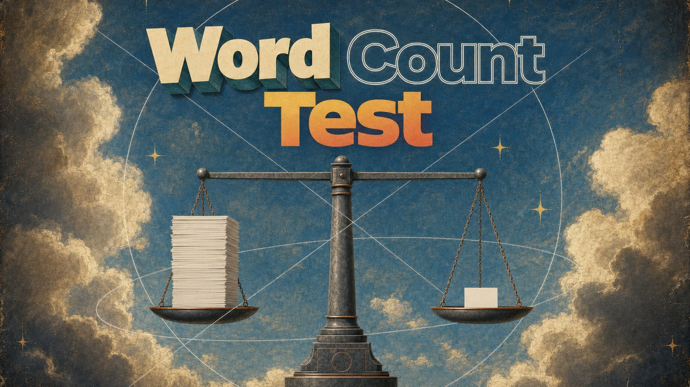
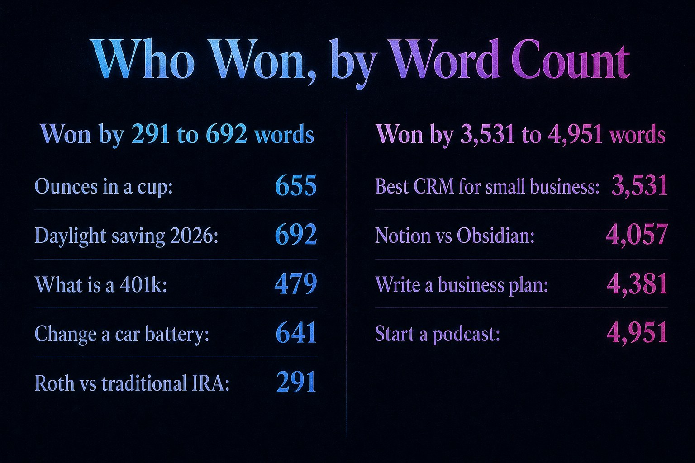
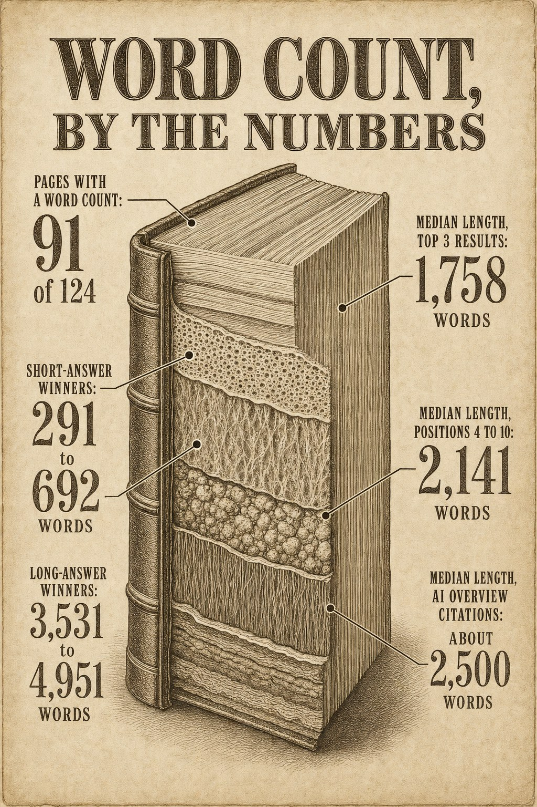

The 'write 3000 word blog posts' advice is a decade old, and many teams still use it as gospel.

On October 19, 2026, the team at [RankControl, an AI SEO and AEO platform](https://rctrl.com), where I work, tested it against 14 Google searches, from "how many ounces in a cup" to "best crm for small business".

So we measured the word count for each page we could measure that was in the top 10 or cited/listed as a source in a Google AI Overview, the AI-generated answer Google displays above some search results, for each search.

Of the 10 searches where we could measure the page that ranked first, 4 were won by pages of 3,531 to 4,951 words. 5 of them were 291 to 692 words. And 1 of them was 1,484 words.

That pretty much just depended on what the searcher was after.

The test was first posted by RankControl. They posted it on Oct 24, 2026. It was called [Long Form Content: When 3,000 Words Wins And When It Doesn't](https://rctrl.com/blog/long-form-content). Here are the numbers with the sources that I double checked on Nov 12, 2026.

## What Google says about word count

Google's helpful content guidance has a set of questions that can indicate a page was not created for humans, but rather for search engines.

One is: "Are you writing to a particular word count because you've heard or read that Google has a preferred word count? (No, we don't.)"

The footer of the [Google Search Central page](https://developers.google.com/search/docs/fundamentals/creating-helpful-content) says it was last updated on October 5, 2026 (UTC) 
 I was there on the 12th of November 2026. The sentence is still there. 
 We interpret that as length is not a ranking factor on its own. But length often includes what's important: All the steps. All the comparisons. The subsequent questions.

That is why long pages win some searches and lose others.

## How we checked

**What we counted.** We took the top 10 Google results and what Google AI Overview pages it referenced for the 14 searches and counted the number of words on those pages. The top page won a search.

**When.** October 19, 2026. November 12, 2026 is the day on which the quotes, dates, links, etc. below were re-opened.

**Sample.** 124 pages (91 countables). Video, social, and some blocked pages couldn't be counted. 19 of the countables mentioned in AI Overviews.

**Limits.** The count is the whole thing, including menus and footers, on a page, so the article itself is slightly smaller than the count. Fourteen searches on one day is pretty small.

We didn't have a measurable page in first place in four of the searches, so the below table is 10 rows, but the medians below use all 14 searches.

## The ten searches we can show

In the table, words on the first page that ranks and median word count of top 10 (if you sort them by length and pick the middle one) for each search for which we could measure first result.

| Type of search | Search | Words on the #1 page | Median of the top 10 |
|---|---|---|---|
| Quick fact | how many ounces in a cup | 655 | 1,242 |
| Quick fact | when is daylight saving time 2026 | 692 | 692 |
| Definition | what is a 401k | 479 | 962 |
| How-to | how to change a car battery | 641 | 1,426 |
| Comparison | roth ira vs traditional ira | 291 | 1,079 |
| Best-of | best crm for small business | 3,531 | 2,877 |
| Comparison | notion vs obsidian | 4,057 | 3,175 |
| Guide | how to write a business plan | 4,381 | 3,768 |
| How-to | how to start a podcast | 4,951 | 5,937 |
| Product | invoicing software | 1,484 | 1,682 |

So from the table, the top page for 6 out of 10 rows had a shorter length than the top-10 median length of the search.

For one it was the same (daylight saving time at 692 words)

For 3 it was longer (best crm, notion vs obsidian, business plan guide).

We couldn't tell length from the search label. The two how-to searches were 641 (car battery) and 4,951 (podcast). The two comparison searches were 291 (roth ira vs traditional ira) and 4,057 (notion vs obsidian).

The one product search, invoicing software, sat in the middle at 1484 words vs a median of 1682 words.

*Word counts from RankControl's October 19, 2026 check of 14 Google searches.*

## Short pages won the short questions

With 655 words, a page from the National Institutes of Health took the top spot for "how many ounces in a cup". For "what is a 401k", it was the 479 words of the page at Investor.gov.

If you're looking for the quick answer, the short version won.

AAA's guide on car batteries was 641 words long, the number of words on the first spot for "how to change a car battery". A 692-word USA Today article took daylight saving time.

Searchers just want to get one single answer. They don't like long pages because then they have to scroll. Maybe Google understands that.

Even "roth ira vs traditional ira" (comparing two retirement accounts in the US) pointed to the calculator page of a bank (291 words long). Something that would satisfy a searcher who is really looking to decide which retirement account they should use.

## Long pages won guides and comparisons

When the reader has to learn something, or they have to make a choice, then the winners tended to be wordy. Shopify's guide on business plans came in first for "how to write a business plan", coming in at 4,381 words. 
 Buzzsprout's podcast guide came in first for "how to start a podcast". It's the most wordy first place page in the table. (4951). The top 10 median for "how to start a podcast" was the most wordy as well. (5937).

Top "notion vs obsidian" page was 4,057 words and top "best crm for small business" page 3,531.

Let's say you want to start a podcast. You're going to need gear, hosting, recording, editing, launch stuff.

Let's say you need CRM (customer relationship management software to track customers and sales). You want to know prices, features, verdict for your type of business.

We don't think you can fit either of these jobs in 800 words. These are the kind of searches the 3k word rule is created for.

## Longer did not mean higher

For all 14 searches, the first 3 items were a median of 1758 words. Items 4-10 were a median of 2141 words.

Within a search, there was no improvement (in ranking) when you were longer than surrounding pages.

Common thing people do is compare the other pages. So they write 20% more. So if top is 1500 words and covers all the stuff - data shows no sign that fatter 3000 words page will beat it.

A more useful page might, though.

*Word counts from RankControl's October 19, 2026 check of 14 Google searches.*

## What Google's AI Overviews cited

Google's AI Overviews cited 19 pages we could measure. Their median length was about 2,500 words, a little above the ranking pages.

The range was wide: 777 words for the IRS's page on IRAs at the low end and 11,272 for Moz's SEO audit checklist at the high end.

AI Overview for Roth IRA search: They put the 5009-word Vanguard guide next to the 1697-word Schwab page and that 777-word IRS page.

It wasn't a matter of length. What the cited pages shared was a clear answer on a logically self-contained section.

[A thread in r/seogrowth](https://www.reddit.com/r/seogrowth/comments/1vlcmzd/do_you_think_longform_or_shortform_blog_articles/), posted on August 11, 2026 and showing 20 upvotes and 39 comments when I checked, asked whether long-form or short-form blog articles are cited more by AI.

One reply said a 700-word page that gives the exact answer, evidence and useful context for a query can be more cite-worthy than a 3,000-word article that takes forever to get there.

Someone else's response said: a lengthy, meaty post gets referenced a lot, whereas a fat one of the same length doesn't.

The reason given for that was: The AI needs to read 800 words of preamble to reach the answer, so it'll take someone else's better formatted version.

## What other site owners report

Our numbers come from 14 searches, so it's good to compare with what people are getting on their own sites.

August 12th 2026:
a blogger wrote on [r/content_marketing](https://www.reddit.com/r/content_marketing/comments/1vmoz5h/37_of_my_80_blog_posts_are_actively_performing_in/) that out of 80 articles (about 20 months of publishing) 37 articles are appearing in Google's AI Overviews or Google chat style AI Mode

They checked in Google's free Search Console for website owners (in the "Generative AI features" report).

There were 37 pages that had 571 impressions (how often that page showed up in these results) in the last 3 months.

Per the post, the best performers were longer, explainer-type articles that directly answer questions.

Replies pushed on the next question, basically that getting referenced in an overview vs being visited are two different things, so the clicks on those 37 pages are more important than the number.

There was a discussion in r/b2bmarketing April 29, 2026 whether 3k word posts are dead. The top reply was they aren't, fluffy are, if it requires 3k words write it, if it requires 600, stop there.

Which is what we see in our table, just more concisely.

## When 3,000 words wins

Go long when the search needs it. These are the usual cases.

- Step-by-step guides with many stages, like "how to start a podcast" (4,951 words in first place) and "how to write a business plan" (4,381).
- Comparisons and best-of lists, where each option needs prices, features and a verdict, like "notion vs obsidian" (4,057) and "best crm for small business" (3,531).
- Topics where people have several follow-up questions in a row.
- Original research, where the data and method need room.
- Pillar pages that link out to a cluster of smaller pages.

## When it doesn't

Stay short when the question is short.

- Quick facts, conversions and dates, like "how many ounces in a cup" (655 words in first place) and "when is daylight saving time 2026" (692).
- Simple definitions where the searcher wants one clear paragraph, like "what is a 401k" (479).
- Calculators, tools and pages where the answer depends on the reader's own numbers, like the 291-word calculator page that won the roth ira search.
- Local service pages, where a phone number and price range matter more than history.

For these, a short page that answers in the first line and then adds a little useful context will usually beat a long one.

A 3,000-word post on "how many ounces in a cup" would be up against the 655-word National Institutes of Health page, and nothing in the data suggests the longer page wins.

But that doesn't necessarily make it too long at 3000 words. 3000 words is okay if everything's justified, but it's too much if it's just fluff over a simple answer.

## How to choose the length for a page

Instead of having a word count target, do this.

1. Search your keyword and open the top three results.
2. Note what they cover, not how long they are, by listing the steps, options or questions each one answers.
3. Count roughly how long they are, only to see whether the search wants a short answer or a full guide. If they are short answers, write a short, clear answer. If they are full guides or comparisons, expect to need similar depth, usually 2,000 words or more. The four long-answer searches in the table had top-10 medians between 2,877 and 5,937 words.
4. Write a page that covers everything they cover, plus what they missed, and nothing else.
5. Stop when the reader's question is fully answered.

## Writing long pages that AI can lift from

If it's a big page, each section should be self-contained. The retrieval system of ai answers (this is the part of an ai search tool that decides which passages are interesting enough to quote) will often chunk up a long page and take the most obvious one.

August 5th, 2026. SEO guy Charles Floate (@Charles_SEO) released this free prompt on X. It divides a page into chunks of ~300 tokens (similar to how a retrieval system would) and it checks if each chunk is valid on its own.

A token is a little bit of text (typically a short word or a part of a word). So this test ultimately boils down to four habits:

- Open each section with the answer to its heading.
- Repeat the subject by name instead of "it" at the start of a section.
- Put numbers next to their sources.
- Keep the preamble short, because the intro is the part readers and AI both skip.

## What this costs in hours

RankControl's estimate is 8-12 hours of work for a 3000 word guide. Research, write, fact check, get it properly formatted.

For a 700 word answer page - 2-3 hours.

You will also need 20-30 minutes per page to check the top 3 for each of your searches before you begin. This is what prevents you from accidentally writing the wrong length.

RankControl's content engine [writes 1,500 to 4,000+ word articles in your brand's voice, based on the pages already ranking](https://rctrl.com/content-engine), and plans each article from live search data.

Its default length follows the format, 1,500 to 3,500 words for guides and 800 to 1,500 for explainers, and any single article can override it.

RankControl's AI visibility tracker tracks citations across 7 AI engines (ChatGPT, Perplexity, Claude, Gemini, Grok, Google AI Mode and Google AI Overviews) and checks every tracked query weekly, which shows which of the finished pages those engines cite.
