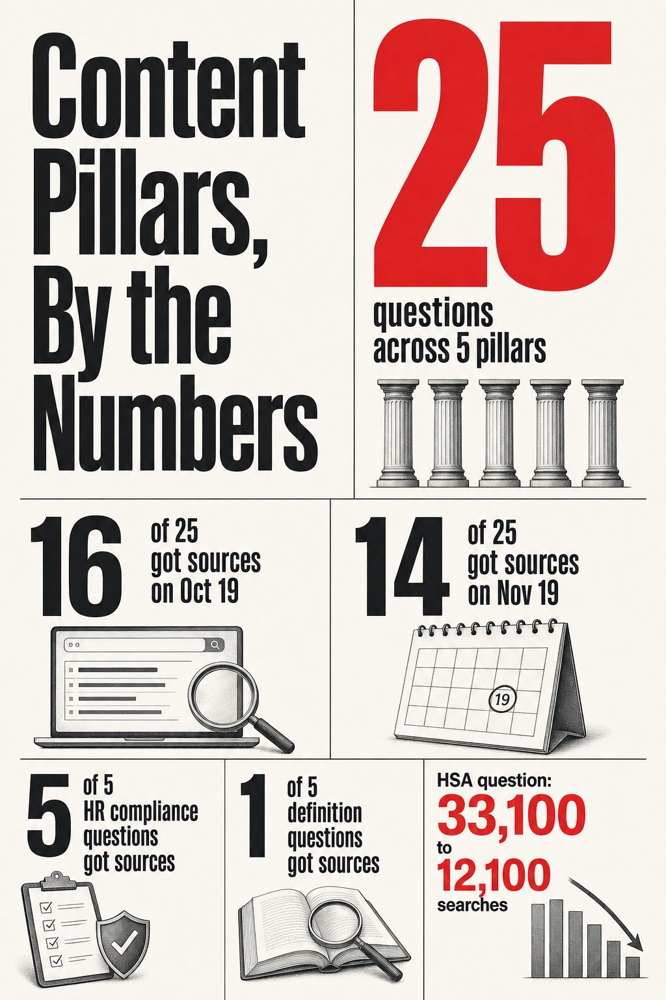

The August 15 2026. A person who helps a buddy w/ license plate mount store, asked [r/SEO](https://www.reddit.com/r/SEO/comments/1vp5dxs/ecom_content_pillar_advice/) (a reddit community that discusses SEO stuff) if they should create content about car culture, racing, car history and so on. Person noted that for a single product site, there's not much to write about. The highest rated comment (2 upvote as of Nov 19, 2026, when I checked the thread) suggested to be 1 step away from purchase, and write about plate laws for each state, front plate laws, sensors that a plate mount can interfere with.

That response would be a definition of content pillars, which are the 3-5 topics your business writes about repeatedly that connect back to your products/services. But in 2026 you need pillars to work in the AI-powered responses (the ones that ChatGPT, Perplexity or Google AI features auto-compose from web sources), and some topics get treated very differently than in Google by these engines.

On October 19, 2026, the team at [RankControl, an AI SEO and AEO platform](https://rctrl.com), where I work, scored five candidate pillars for a payroll software company on 25 questions. RankControl published the result on October 31, 2026 as [Content Pillars: How To Choose Them For Search And AI Answers](https://rctrl.com/blog/content-pillars). On November 19, 2026, I re-read every source that post uses and ran all 25 questions again, twice, so most numbers below carry two dates.

3 things that were consistent for both: always gave web sources for all 5 hr compliance questions; always gave sources for 1 of the 5 'what is' questions (1 source per time); for the single pillar that they cited the Gusto payroll co, it was always Payroll & same 2 questions for that pillar.

Two results moved. The estimated monthly searches for Benefits fell from 34,490 to 13,790 because one question, "what is an HSA" (a health savings account), went from 33,100 to 12,100, and the number of questions where Gusto sat in Google's top 10 went from 5 on October 19 to 2 and then 0 on November 19.

## How we checked

**What we counted.** In this example let's say it's a payroll software company (with Gusto being the example payroll company). We selected 5 potential pillars (Payroll, HR compliance, Hiring, Benefits, Small business finance) and grabbed 5 common questions from each (25 total). For each question we pulled the estimated monthly US searches from Google Ads keyword data, whether web sources were included in the ChatGPT answer and whether Gusto appeared in Google top 10 and/or the sources for ChatGPT.

The ChatGPT and Google results come from DataForSEO, a search-data provider, using its ChatGPT scraper (US, English, no login) and its Google results API.

**What "listed sources" means.** An answer counts as listing sources when the scraper returned at least one source link for it. RankControl's October check used the same rule and called it "ChatGPT searched". [OpenAI's Help Center](https://help.openai.com/en/articles/9237897-searching-the-web-with-chatgpt) says ChatGPT may search the web automatically when a question would benefit from current information, that answers which use web search may include citations, and that ChatGPT typically rewrites the question into one or more targeted queries. I read that page on November 19, 2026.

**When.** October 19, 2026. RankControl did 25 questions. On November 19, 2026, I did them twice (around 15:35 and 15:40 - GMT+7) also. Then re-opened other sources on November 19 as well: these 2 Reddit threads below and Ahrefs blog's menu, the live RankControl's post (text in it = source file text) and RankControl's AI visibility page.

**Sample.** 25 questions. 1 read on October 19, 2 reads on November 19. 75 chats with ChatGPT 75 pages in Google results.
2 Reddit threads. Everything read in full using Reddit data API (Reddit show bot-check page for scripts)

**Limits.** (it's all US, all English, desktop. monthly searches are guesses from provider, pulled only once on Nov 19. Nov 19 scraper identified ChatGPT model as "gpt-6" and Oct file from RankControl doesn't retain model name so I don't know if it changed or not.)

On November 19th the scraper also got the search queries that were done by ChatGPT. For 3 of the 25 answers (form I-9, first employee hire, bookkeeping) there's no query at all, and they are counted as searched in the October rule but would not be if taken literally.

Between my two November calls, 5 minutes apart, Google's results changed. Now the provider gives you Google redirect links. I've been reading the address shown for the domain.

For 2 of 25 answers, ChatGPT decided to show sources differently between my two runs so we're going to need more than one read for each question.

For Gusto...that's our own example, not a Gusto content plan.

## What a content pillar is, and what it is not

Note that a content pillar is a theme (like payroll or hiring if you're a payroll software company). It's not a page. The central page on a theme is called a pillar page. And a topic cluster is the collection of linked pages you create within a pillar (generally it's a main guide and then some shorter pages that answer more specific questions). But what this post describes is the step before the content pillar/topic cluster: the theme selection process.

You can see this on big software blogs. On November 19th, 2026, I went to the Ahrefs blog and their topic menu had: Data & Studies, Product Updates, AI Search, a Marketing group with 5 topics (General Marketing, Content Marketing, Affiliate Marketing, Paid Marketing, Video Marketing), and a SEO group with 7 topics (General SEO, Keyword Research, On-Page SEO, Link Building, Technical SEO, Local SEO, Enterprise SEO).

That's two parent themes: marketing and SEO. Then you've got data studies and AI search. RankControl says those relate to jobs you might use Ahrefs for.

## How many pillars you need

3-5 is the common response. Check out October 14 2026 thread on [r/content_marketing](https://www.reddit.com/r/content_marketing/comments/1x60cuw/if_im_writing_about_content_strategy_for/). It explains why this question comes up. There was a writer who wanted to kick off a substack newsletter about newsletter strategy. They want to know how to pick content pillars. This thread had 28 comments on November 19 when I checked it. The highest rated answer is that you should pick a niche for a specific target market. Have a max of 3 or 4 pillars. Out of the 12 top level replies from people that we can see, 6 answered with a number. And all of them mentioned 3 or 4 (one mentioned 3 broad buckets).

There's another response in that thread that suggests a short cut, do 8-10 first and see what groups they fall into, because whatever you are gravitating to is going to be a pillar and now you've got the proof that you can carry it. I saw two responses in there that echoed the backward approach. r/SEO response from August 15 has a number to back it up. Before you jump to 30-50 you should do 6-8 articles in 2 clusters. Track qualified impressions, product page assists and conversions, instead of total blog traffic.

Fewer is better for small teams, in RankControl's view. A team publishing four posts a month writes 48 articles a year, which is 16 per pillar across three pillars and about 7 per pillar across seven. Each pillar needs enough articles to look like real coverage.

## The two-scoreboard test

You used to choose pillars by just looking at search demand. Now, you have two scoreboards: Google, and AI answers. You can win one but lose the other. RankControl calls it a two-scoreboard test. Here's how it works for one company. There are 25 questions.

Table 1 gives the pillar totals on the three readings. A pillar scores well on the AI scoreboard when ChatGPT's answers list sources for most of its questions, because those are the answers a site can be cited in.

| Candidate pillar | Searches a month, Oct 19 | Searches a month, Nov 19 | Answers with sources, Oct 19 | Answers with sources, Nov 19 run 1 | Answers with sources, Nov 19 run 2 |
|---|---|---|---|---|---|
| Payroll | 17,700 | 18,000 | 4 of 5 | 4 of 5 | 3 of 5 |
| HR compliance | 18,430 | 18,430 | 5 of 5 | 5 of 5 | 5 of 5 |
| Hiring | 1,290 | 1,340 | 2 of 5 | 2 of 5 | 2 of 5 |
| Benefits | 34,490 | 13,790 | 2 of 5 | 1 of 5 | 2 of 5 |
| Small business finance | 10,630 | 10,630 | 3 of 5 | 2 of 5 | 2 of 5 |
| All 25 questions | not summed | not summed | 16 of 25 | 14 of 25 | 14 of 25 |

Table 2 shows the Gusto columns, as the number of the five questions in each pillar.

| Candidate pillar | Gusto in Google's top 10, Oct 19 | Nov 19 run 1 | Nov 19 run 2 | Gusto cited by ChatGPT, Oct 19 | Nov 19 run 1 | Nov 19 run 2 |
|---|---|---|---|---|---|---|
| Payroll | 1 | 2 | 0 | 2 | 2 | 2 |
| HR compliance | 1 | 0 | 0 | 0 | 0 | 0 |
| Hiring | 1 | 0 | 0 | 0 | 0 | 0 |
| Benefits | 2 | 0 | 0 | 0 | 0 | 0 |
| Small business finance | 0 | 0 | 0 | 0 | 0 | 0 |

I didn't see any volume for a few of the questions (6/25 each time on both dates). So just take the search counts as the minimum.

*Counts from RankControl's October 19, 2026 test and my two reruns on November 19, 2026.*

The 25 questions, with the estimated monthly searches on November 19 (October 19 in brackets where the provider's figure changed) and how many of the three readings listed sources:

| Pillar | Question | Searches a month | Readings with sources |
|---|---|---|---|
| Payroll | how to run payroll for a small business | no figure | 3 of 3 |
| Payroll | how often should I pay employees | no figure | 2 of 3 |
| Payroll | how to calculate payroll taxes | 1,600 (1,300) | 3 of 3 |
| Payroll | what is a pay stub | 14,800 | 0 of 3 |
| Payroll | best payroll software for small business | 1,600 | 3 of 3 |
| HR compliance | what is form i-9 | 18,100 | 3 of 3 |
| HR compliance | how to classify employees vs contractors | no figure | 3 of 3 |
| HR compliance | what labor law posters do I need | 10 | 3 of 3 |
| HR compliance | how to handle a workplace harassment complaint | no figure | 3 of 3 |
| HR compliance | do I need workers comp insurance | 320 | 3 of 3 |
| Hiring | how to hire your first employee | 140 (110) | 3 of 3 |
| Hiring | how to write a job description | 880 | 0 of 3 |
| Hiring | what to include in an offer letter | 40 | 0 of 3 |
| Hiring | how to onboard a new employee | 170 | 0 of 3 |
| Hiring | how to do a background check on an employee | 110 (90) | 3 of 3 |
| Benefits | how to offer health insurance to employees | 90 | 3 of 3 |
| Benefits | what is a 401k match | 1,600 (1,300) | 0 of 3 |
| Benefits | how to set up a pto policy | no figure | 2 of 3 |
| Benefits | what is an hsa | 12,100 (33,100) | 0 of 3 |
| Benefits | what benefits do small businesses offer | no figure | 0 of 3 |
| Small business finance | how to get a small business loan | 4,400 | 3 of 3 |
| Small business finance | how to make a budget for a small business | 30 | 0 of 3 |
| Small business finance | what is cash flow | 5,400 | 0 of 3 |
| Small business finance | how to pay yourself as a business owner | 590 | 1 of 3 |
| Small business finance | how to do bookkeeping for a small business | 210 | 3 of 3 |

Form I-9 is the US form that confirms a new hire may legally work, and a 401k match is money an employer adds to a worker's retirement account.

Of the 25 questions, 13 listed sources in all three readings, 9 never did, and 3 changed (how often should I pay employees, how to set up a pto policy, and how to pay yourself as a business owner). Between any two readings, 2 of the 25 answers flipped between listing sources and not listing them.

## What the scores say

**Benefits.** Oct 19: Benefits was by far the most Google demanded with 34,490 per month for 5 questions. Mostly for 1 question "what is an HSA" with ~33,100 per month. ChatGPT answered this question without a source. And "what is a 401k match". Nov 19: Provider put "what is an HSA" at 12,100. Monthly for this over months is 18,100 max. Benefits dropped to 13,790. 3rd. Behind HR Compliance 18,430. And Payroll 18,000. Not sure what happened that this was higher in October.

ChatGPT listed no source for either of the two questions in all three readings, so on the AI scoreboard Benefits barely scores on any date.

**HR compliance.** HR compliance was the opposite. On October 19, ChatGPT listed sources for all five questions, from "what is form I-9" to "do I need workers comp insurance", and both November runs matched with 5 of 5. In RankControl's reading, the model looks these up because the rules change and vary by state.

The November queries fit that. For "how to classify employees vs contractors" ChatGPT sent 3 search queries (per run). For example, "irs worker classification test" or "US department of labor contractor rule" - 3 and for "how to handle a workplace harassment complaint" - 2. 
So, one of the big AI pillars is compliance. Gusto was not cited for any of the five on any date.

**Definitions.** I found the most consistent trend with definitions. When asking 5 "what is" questions (paystub, form I-9, 401k match, HSA, cash flow), ChatGPT provided sources to 1 of them (form I-9) on October 19 and both times in November. The single source in November was to a USCIS page, no search query was recorded.

Interestingly, the same 5 questions had some of the highest Google volumes. 18,100 google for form I-9; 14,800 for pay stub, 5400 for cash flow, 1300 for 401k match (1600 as of Nov 19), 33,100 for HSA (12,100 as of Nov 19). RankControl noted the same pattern in their previous research on how often ChatGPT is searching the web. When it did a lookup, the search happened. And when it had a consistent answer, it usually didn't.

The five non-definitions out of 9 questions that were not sourced:

how to write a job description, 
what to include in the offer letter, 
how to onboard a new hire, 
how to create a budget, 
what benefits small businesses offer

**Hiring.** The strange one. The five questions totaled 1,290 searches a month on Oct 19, 1,340 on Nov 19. It's far and away the smallest pillar. ChatGPT gave sources for two of these questions on all readings. "how to hire your first employee" and "how to do a background check on an employee". It's pretty bad looking on both scoreboards.

But the "how to hire your first employee" is the point where a business is going to need to run payroll for the first time, and as of October 19 there was a Gusto page (go.gusto.com) in the top 10 in google search for it. As of November 19, neither of those runs had a gusto page in the top 10 for the "how to hire your first employee" question. So there was no repeat in the example on that half.

You might be able to get more value out of a small pillar right before the point of purchase rather than a large one far away from it. Thus, a fourth less strong indicator of scores would be proximity of each pillar's questions to the point of purchase. For this company, recruiting might remain a smaller pillar with less articles and focus on first time employers. It doesn't have to have the same number of posts like payroll to be important.

## Check whether you can win the pillar

Demand and AI behavior are not enough, because some pillars belong to someone else. Small business finance looked fine on demand, with 10,630 searches a month across its five questions on both dates. On October 19, Google's top 10 for those questions held QuickBooks for 3 of the 5, Bank of America, Chase and NerdWallet for 2 each, and Wells Fargo for 1, and Gusto showed up for none. A payroll company would spend a year fighting banks for loan and budgeting searches.

The November 19 results pages were less crowded: the first run showed QuickBooks for 1 question, the second showed QuickBooks, Bank of America, Chase and NerdWallet for 1 question each, Wells Fargo for none, and Gusto still appeared for none.

The only pillar ChatGPT mentions using Gusto for (on October 19 and both times in November for "how to run payroll for a small business" and "best payroll software for small business") is payroll.

This is the core of the business. This is where the authority is already.

The Gusto column shifted more with Google. We had Gusto in top 10 of Google on October 19 for 5 out of the 25 questions (1 in Payroll, 1 in HR compliance, 1 in Hiring, 2 in Benefits). In the first run for November we had 2 in top 10 (both Payroll). In the second run 0. For "best payroll software for small business", we had a product page from Gusto at spot #1 in the first run. In the second run we had 3 paid ads in top and 0 Gusto page.

So for this company, the October scores point to three pillars. Payroll is the home ground. HR compliance is the AI opportunity.

Benefits carries the Google demand and stays as long as the articles go past definitions into setup questions like "how to offer health insurance to employees", which ChatGPT searched for in all three readings (1 search query in the first November run and 2 in the second). The November 19 figures shrink the Benefits case, since it ranks third by searches, but the ChatGPT columns that carry the other two pillars moved by only 2 answers between any two readings.

## How to choose your own content pillars

Here is the process we used, in order, with what each step looked like in the test.

1. List what your product helps people do. Each job is a candidate pillar; ours were payroll, HR compliance, hiring, benefits and small business finance.
2. Add the problems buyers hit just before and after buying, the "one step from the purchase" rule from the r/SEO thread.
3. Write five real questions for each candidate, in the words buyers use. We used 25.
4. Check monthly searches for each question in any keyword tool. Six of our 25 had no figure, and the HSA question's figure moved from 33,100 to 12,100 in a month.
5. Ask each question in ChatGPT and note whether the answer shows sources. I asked twice on November 19, and 2 of the 25 answers flipped between the two runs.
6. Search each question on Google and note who holds the top results. The same query returned different pages for Gusto five minutes apart.
7. Keep the three to five pillars that pass at least two checks, and drop the ones another type of company clearly owns.

Then name your pillars the way Ahrefs names its topics, after jobs people recognize, and file every new article under one of them.

## Common mistakes with content pillars

The most frequent is the instinct of the r/SEO post: trying to choose themes people want but which the product isn't able to provide. The person posting identified HubSpot as a threat, and there were two responses talking about how HubSpot content was so far removed from their buyers' needs (though one response pointed out that at this store their audience is closer to the buyers than in HubSpot).

Another is basing your selection of pillars purely on Google volume. For instance, for definitions you get huge numbers. And those were the least likely in our test that ChatGPT provided a source for. Examples like "what is an HSA" with 33,100 searches per month October 19. And it had 0 source in any of the three readings. And it dropped to 12100. So if you're basing a pillar off one big number, you're basically basing it off an estimation that can change in a month. So if AI responses are important to you, RankControl opinion is the ones to give more weight to are where the engine is searching for.

Last thing is letting the pillars stagnate. If the topic is HR compliance, for example, then you need to keep the pages relevant. That's why ChatGPT searches for it anyway.

## What choosing pillars takes by hand

Here's what RankControl thinks their first round budget for pillar research is, more or less.

| Task | Hours |
|---|---|
| Listing jobs and buyer problems | 1 to 2 |
| Writing five questions per candidate | 1 to 2 |
| Checking search demand | 1 |
| Running the questions in ChatGPT and Google | 2 to 3 |
| Scoring and choosing pillars | 1 to 2 |
| Total for one round | 6 to 10 |

To give some context, the manual ChatGPT/Google step is estimated to take 2-3 hours, whereas my two scripted runs of that step from November 19th were in the 3-4 minute range. I was charged $0.24 for the first one with volume look up. Second one was $0.15. From the provider.

## Doing it by hand or with help

RankControl's post says you can run this test yourself once a quarter, or hand the steady part to RankControl. RankControl's AI visibility tracker tracks [citations across 7 AI engines: ChatGPT, Perplexity, Claude, Gemini, Grok, Google AI Mode and Google AI Overviews](https://rctrl.com/ai-visibility). On the page I read on November 19, 2026, it checks 50 of your buyer questions every week, so you can see which pillars are earning citations.

RankControl's content engine covers the writing side. It plans articles from live search data, your brand profile and the pages already on your site, writes them, and holds each one for review unless you turn on auto-publish.
