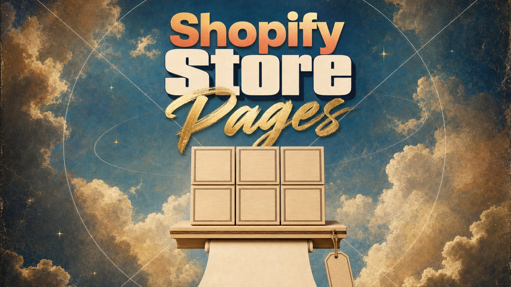

At least seven of the store pages in Google's top 10 results for eight everyday product searches ran on Shopify, the hosted platform that many online shops are built on. That came out of a pull of Google's results on October 19, 2026.

Six of the seven were collection pages, the page that lists every product in one category, and the seventh was a single product page. Five of the seven had titles close to the search shoppers typed, and the product page was the only single product page in any of the eight top 10 lists.

The pull was run by the team at [RankControl, an AI SEO and AEO platform](https://rctrl.com), where I work, for a post it published on October 21, 2026, [Shopify SEO: How To Rank Your Store In Google And ChatGPT](https://rctrl.com/blog/shopify-seo-rank-google-chatgpt). SEO is search engine optimization, and AEO is answer engine optimization, which means getting your pages quoted in AI answers such as ChatGPT's.

On 19th November 2026 I re-opened my saved pages for that check. I did the searches again. I asked ChatGPT the same 8 questions. Here's what stayed the same and what changed.

TLDR: named pages so they match what people search for. Half of the collection pages had a buying guide below the product grid. The structured data (the code that helps search engines understand what facts are on the page) was less important than I thought. The page that was referenced by ChatGPT was the one that clearly calls out its price and specs.

A month later, none of the seven pages were in the top 10 for their search, which I cover after the findings.

## How we checked

**What was checked.** For eight queries (stand mixer, running shoes for flat feet, office chair for back pain, dog food for sensitive stomach, pour over coffee grinder, hiking backpack 50l, noise cancelling headphones, moisturizer for oily skin) the top-10 results from Google were scraped via search data service DataForSEO on October 19, 2026 (18:59 - 19:00 UTC, October 18).

US, English, desktop. It saved the code from all seven Shopify pages. Also the coffee grinder page of Fellow, which ChatGPT mentioned in the October test (separate test). There was an error page (BrandsMart USA, collection of stand mixers) which was saved as page #9 in October copy. It's 404 again on November 19 so not including it.

**When I re-checked.** Everything below dated November 19, 2026 is mine. I loaded the eight page addresses (each returned HTTP 200) and compared their code with the October copies. I re-ran the eight searches with the same settings, plus the top 30 for the five searches that had Shopify pages.

I asked each of the 8 searches through cloro (saves answers from logged-out ChatGPT app in US w/ web search on). And re-read 4 reddit threads via AgntData API and reopened help pages for OpenAI/Google/Shopify.

**Sample.** 7 pages from Shopify (6 collection pages, 1 product page), Fellow's product page, 25 pages ChatGPT used in my 8 asks, 4 threads on Reddit. 
 **Limits.** 8 searches from the same country, on the same device, pretty low sample, two days separated by a month. Whether it's on Shopify was determined by the code (Shopify script and image urls), I only looked at the pages mentioned. So it's "at least" 7 pages.

"Title close to the search" is a judgement. I judged the same way that RankControl judged it. 
 Since Google's November has redirects of links in place of page address, I judge by site's name that appears under each title. 
 ChatGPT answer varies depending on the asks. I only searched each once.

9/25 pages it was pointing to gave me a block or an error, so I sorted that by address only. I didn't re-run October ChatGPT test in RankControl, so all the numbers below are RankControl's.

## What Shopify already does for you

Shopify provides an SEO summary in their [Help Center](https://help.shopify.com/en/manual/promoting-marketing/seo/seo-overview) and they mention what they do for you out of the box: create canonical tags, sitemap.xml and a robots.txt for your store. A canonical tag lets search engines know what the main version of a URL is. A robots.txt tells crawlers which pages to ignore. That's a lot of tech stuff you get out of the box on every store.

Fixes a problem that many shop owners are concerned about.

You can see your Shopify product on 2 different URL: plain URL /products/ and in duplicate URL under the collection /collections/.../products/....

In RankControl's October test ChatGPT mentioned Fellow Ode Brew Grinder Gen 2 page. It used nested url.

And on 19 November I went to that nested url.

It returned HTTP 200, and its canonical tag pointed to fellowproducts.com/products/ode-brew-grinder-gen-2, the plain address, which is Shopify's default, so search engines still know which version to index. The rest of this post is about the pages, not the settings.

## The seven pages

Here are 7 pages with the search they came up for and where they were in the regular results (the blue links, not the AI answer or the shopping boxes) from the October 18 pull.

| Search | Store and page | Type | Position on Oct 18 |
|---|---|---|---|
| office chair for back pain | Desky, "Ergonomic Office Chairs" | Collection | 1 |
| hiking backpack 50l | Six Moon Designs, "50L Backpacks" | Collection | 2 |
| hiking backpack 50l | Ampex Gear, "Hiking Backpack 50L" | Product | 3 |
| dog food for sensitive stomach | HardyPaw, "Sensitive Stomach Dog Food" | Collection | 6 |
| pour over coffee grinder | Seattle Coffee Gear, "Coffee and Espresso Grinders" | Collection | 7 |
| dog food for sensitive stomach | Muenster Pet, "Sensitive Stomach Dog Food" | Collection | 8 |
| moisturizer for oily skin | Photozyme, "Best Moisturizer For Oily Skin" | Collection | 8 |

Stand mixer. Flat feet running shoes. Noise cancelling headphones.

None of the 7 had any of these.

For the other 5 searches, I used RankControl to get the HTML for each page, and then counted up what it returned. I did the same counting on the October saved versions and matched the same numbers for each row. Then I counted them on the live ones.

| What was checked | October 19 | November 19 |
|---|---|---|
| Title close to the shopper's search | 5 of 7 | 5 of 7 |
| Buying-guide section under the products | 3 of 6 collection pages | 3 of 6 |
| CollectionPage structured data | 2 of 6 collection pages | 2 of 6 |
| Breadcrumb structured data (the Home > Category trail) | 3 of 7 | 4 of 7 |
| Product and Offer structured data | The product page, yes | Yes |

Within a month, 2 stores have updated their code. In that time, Desky added breadcrumb info to its chair collection, this moves their row from 3 to 4 of 7. They also re-wrote their meta description (what appears as a brief summary below a result in google). Their meta description now starts with lumbar support, adjustable armrests, 6 year warranty.

Seattle Coffee Gear added list (ItemList) on their grinder page and changed meta description to mention Eureka, Baratza and Fellow grinders and pour over brewing. Title is the same for all other 5 pages and same type of structured data for both dates.

*Figures from RankControl's October 19, 2026 check of eight Google searches and my November 19 re-check, including 25 pages ChatGPT cited that day.*

### Titles that match the search

Naming was the clearest habit. Six Moon Designs calls its collection "50L Backpacks", and it ranked second for "hiking backpack 50l". HardyPaw and Muenster Pet both named theirs "Sensitive Stomach Dog Food". Photozyme went furthest, with a page titled "Best Moisturizer For Oily Skin", which is the search for "moisturizer for oily skin" with "Best" added.

We saw 2 other stores that used the broader term but still scored on category: Desky's are "Ergonomic Office Chairs". They came in 1st on their search. Seattle Coffee Gear's are "Coffee and Espresso Grinders". For 1 product page, we saw the same rule: Ampex Gear called their product "Hiking Backpack 50L", same as what they searched for. Only single product page we saw in the top 10 for all 8 searches.

On Shopify generally the name of the collection is going to map to the page address, page heading and title tag. Here's an example on HardyPaw: page address is /collections/sensitive-stomach-dog-food page heading is "Sensitive Stomach Dog Food" and the title tag begins with "Sensitive Stomach Dog Food". If you name your collections based on the terms your customers are searching for (instead of based on an internal classification), all three will get updated.

### Guide content below the grid

3 out of 6 of their ranking collection pages actually had buying advice for the products.

Go down from all the food on the sensitive stomach page on HardyPaw. There's a section for what is dog food sensitivities. There's a section for what to look out for when buying. There's a section for managing them. Then there's their FAQ with 6 questions, starting with "What are the signs that my dog may have a food sensitivity?".

Photozyme's oily skin collection explains why oily skin still needs a moisturizer, which ingredients work and how to layer products. Desky's chair collection answers "How can an ergonomic chair benefit you?" and then runs through eight questions, from "What makes a chair ergonomic?" to "Are gaming chairs the best for your back?".

Nov 19th, word count from first guide heading to end of faq (3 different guide sections) HardyPaw ~ 970 words Desky ~ 1070 Photozyme ~ 1330 same count on the october copies.

Looking at the post from RankControl, a few hundred words under the grid seemed to be the suggestion. I've seen these 3 pages exceed that, so I interpreted "few hundred" as "at least" rather than the size they actually are. Only HardyPaw and Desky actually ask questions as their headers.

Photozyme's are statements such as "Why Oily Skin Still Needs A Moisturizer", so the three share the guide, not the question format.

The other three collection pages had no guide. Muenster Pet's has a three-question FAQ about its own food (whether to trust its quality, how to switch a dog to it, where the ingredients come from), and Six Moon Designs and Seattle Coffee Gear had product grids and no guide section.

RankControl's post says most Shopify stores stop at the short description their theme puts above the grid. Its reading is that a few hundred helpful words below the grid let a collection rank for the shopper's question as well as for the category name, and three pages out of six is the evidence behind that.

### Structured data mattered less than you'd think

The twist. Only 2 of the 6 collection pages (HardyPaw and Desky) had the CollectionPage markup. This is the code "label" that indicates a page is a product listing. On both dates, Muenster Pet had nothing but simple Organization data. Photozyme's page had Organization, Brand, ContactPoint, AggregateRating labels. Breadcrumb trails, simple site data for Six Moon Designs and Seattle Coffee Gear. Simple stuff makes a difference. When you're clear on names. When you write useful copy.

I wouldn't skip schema because of that. Google's ecommerce documentation says [structured data can improve its understanding](https://developers.google.com/search/docs/specialty/ecommerce/share-your-product-data-with-google) of content such as price, discounts and shipping costs on a page, and the product pages that did best in ChatGPT were well marked up.

On November 19, Ampex Gear's product page, the one product page in the top 10, listed its price as $89.99 and its availability as InStock in Product and Offer markup. Markup is just not what decides whether a collection page ranks.

## Where the rankings stood on November 19

But the ranking didn't stick for a month. I re-did the 8 searches on November 19 (with the same settings that DataForSEO ran on October 18) and none of the 7 pages made it into regular search results in the top 10 of the search (for that search). In addition I grabbed the top 30 for the five searches where we had a shopify page.

Found Seattle Coffee Gear at 3rd (for pour over coffee grinder).

They had a different page (a guide called "Best Grinders For Flash Brew And Pour Over").  And the other 6 pages didn't show up. 
 Less than 1/5 of the 66 'regular' results (12 when you include repeats like Reddit, Amazon, YouTube, etc.) from October showed up on the list for November (for all 8 searches).

But AI Overviews (the AI generated answers at the top of the page) continued to mention two of the stores. They listed the product page of Ampex Gear as a source for hiking backpack 50l on October 18 and November 19. On November 19, AI Overview included a Muenster Pet page "Dog Food For Sensitive Stomach & Diarrhea" as a source for dog food for sensitive stomach.

I can't tell from a one time pull if Google has altered these or if it was the datafeed. The Nov response had google redirect links instead of page addresses and the lists were somewhat different in nature. Higher forum threads and marketplace lists. So I'll use Oct as the sample for the above findings and Nov as just another data point.

## What Shopify SEO people say in the forums

Reddit ends up in much the same place. On September 23, 2026, someone in r/ShopifySEO who said they had audited more than 100 Shopify stores posted the four biggest problems they kept finding (3 upvotes and 5 comments when I read it on November 19).

The first was collection pages without even 100 words of useful content on what the collection is about, with the advice to treat every collection as a landing page built to rank and convert, not as a list of products. Product pages came second.

Good one. They listed the following: what your product solves, how to use it, who it's for, why to choose your product over others. And they also asked that stores not just cut and paste the maker's description as-is. The other two issues were topical authority and link building.

On 28 Sep 2026 a new store owner asked the same subreddit about the top three SEO things to know. One of the answers was succinct and helpful: 
 - Put copy on your collection pages. 
 - Make your internal product links link to the canonical product url.
 - Make real collections rather than rely on tag pages. 
 Another answer mentioned FAQs, JSON-LD (which is how most structured data is written) and breadcrumbs.

The middle tip matters most on Shopify.

If a theme links products from a collection at the nested address, the store's own links point at the copy and not the main page, and in the audit thread one reply said that on one store about 1 in 6 URLs turned out to be the same page reached another way, to be cleaned up before spending on content.

So I counted the number of product links on all 6 collection pages. Muenster Pet is the only one whose grid linked to the nested address (oct 19 there were 12 links.  nov 19 there were 11) and the other 5 had links to the simple /products/ address (on oct photozyme had 2 nested links.  Nov 19 nothing).  So it wasn't the majority of themes with the quirk in this example.

## What the page ChatGPT cited does

For AI side, check Fellow's Ode Brew Grinder Gen 2 page.

For RankControl (October pour over grinders), chatGPT crawled Fellow's site by query "site:fellowproducts.com Ode Gen 2 Brew Burr Grinder price specifications" and quote it in response.

Structured data Product, Offer, AggregateRating is present on the page. Also a FAQ FAQPage markup with 5 questions shown next to the details the buyer is comparing. On November 19th this page also had the same structured data types. Title of the page updated with "Get 20% Off" and meta description started with "Black Friday: 20% off through 11/30". RankControl sees that probably ChatGPT searches for price and specs and they were available for quote.

RankControl's rest of the test echoed the same pattern. 10+ product questions (8 October 19 2026 questions, 2 earlier). ChatGPT linked to product pages over other types of store pages most often. (often after first doing a search on the maker's site for specs or price).

The run notes count 34 cited pages in all, 24 of them owned by the brand or a retailer. RankControl's takeaway is that product pages should state the facts plainly, even though they rarely rank for broad searches on Google, and in the October lists one product page did.

On November 19 I entered the 8 searches as a customer would (once for each search) into ChatGPT. It returned 25 pages - 19 product pages, 1 product image (on a retailer's image server), and 5 guides / articles. Not one of the 25 was one of the 7 pages from October. Neither was it Fellow's own page - but it was a retailer's page for the same grinder.

| Search | Pages ChatGPT cited on Nov 19 | What they were |
|---|---|---|
| stand mixer | 3 | Product pages at Home Depot (2) and Walmart (1) |
| running shoes for flat feet | 3 | Guides from Runner's World, RunRepeat and Fleet Feet |
| office chair for back pain | 3 | Product pages at Sihoo, Nouhaus and Hbada |
| dog food for sensitive stomach | 2 | A guide from the American Kennel Club and a Cornell veterinary page |
| pour over coffee grinder | 2 | Product pages at Bella Barista (Fellow Ode Gen 2) and Almenhaz (1Zpresso) |
| hiking backpack 50l | 4 | Product pages at Osprey (2), The North Face and Backcountry |
| noise cancelling headphones | 3 | Product pages at Sony, Bose and Sam's Club |
| moisturizer for oily skin | 5 | Product pages at Walmart (3) and Ulta, plus one Ulta product image |

Four of the 19 product pages ran on Shopify, judged from their code: Sihoo and Hbada for office chairs, and Bella Barista and Almenhaz for grinders. Each carried Product and Offer markup. The fifth chair page, Nouhaus, blocked my request but has the same /products/ address with a ?variant= ending as the other two. That matches the October pattern, with ChatGPT pointing to pages that state a product, its price and its availability.

## Your products in ChatGPT's shopping results

There's another avenue for ChatGPT to access the Shopify store. According to OpenAI's help page for [shopping with ChatGPT Search](https://help.openai.com/en/articles/11128490-shopping-with-chatgpt-search) (it appears to have last been updated 3 days before I read it on Nov 19th), for Shopify merchants product info is already integrated with ChatGPT via Shopify Catalog. Merchants don't need to do anything specific. Shopify Catalog is the product feed Shopify provides for AI shopping tools like ChatGPT.

You can start noticing it on the orders they're placing. I remember an r/shopify thread "Orders from ChatGPT", July 2, 2026 (I think around 45 upvotes 89 comments (on Nov. 19)). Some store owner was noticing more orders directly from ChatGPT and wanting to see what those customers were typing.

A reply pointed to the "Recent searches where your products appeared" panel under Sales Channels, then Agentic, in Shopify's admin, and the same reply noted that ChatGPT strips the query before the referral reaches the store.

The trouble is attribution. On September 18, 2026, another r/shopify owner posted that a customer had found them through ChatGPT while the order showed as direct traffic, and wrote that Shopify only knows about the visits that actually reached the store (1 upvote and 25 comments on November 19).

So if the customer saw the product on ChatGPT and typed in your store address later, that's the later one that's counted by Shopify. I saw a suggestion in a response about just asking "How did you hear about us?" as another data point. RankControl's take on that suggestion is to ask at checkout, which is part of the answer.

## The Shopify SEO plan, in order

If RankControl were working through a store today, this is the order it would take, based on what the ranking pages did.

1. Rename your main collections after the searches shoppers use, then check that the title tag and the page heading match. Six Moon Designs' "50L Backpacks" and HardyPaw's "Sensitive Stomach Dog Food" are the models from the table above.
2. On your top five collections, add a short buying guide below the grid with two to four question headings. HardyPaw's has four sections and a six-question FAQ, and Desky's has eight questions.
3. In the text of your best-selling product pages, state specs, price and stock clearly, as Ampex Gear's markup does with $89.99 and InStock.
4. Give a FAQ to any product that gets the same questions over and over, the way Fellow's page marks up five.
5. Keep out-of-season products live with a back-in-stock note, rather than hiding them. An r/ShopifySEO thread from October 15, 2026 about products that sell out every season (2 upvotes and 9 comments) drew three replies saying to leave the page live. One of them warned that a page reduced to a title and a sold-out badge for months can be flagged as a soft 404 (a page Google treats as an error) in Search Console, Google's free tool for site owners, and suggested a "back in May" line with a restock signup.
6. Write one buying guide per main category on your blog and link it to the matching collection, which is what the audit thread's third problem, no topical authority, asks for.

I'd start with the first two. Both are quick in Shopify's admin, and they're what set the ranking collection pages apart from the rest.

## What this costs in hours

RankControl's estimate, which its post gives without a time study behind it, is that renaming and retitling ten collections takes an afternoon. A useful guide section runs about two hours for each of your top five collections, and tidying the specs on 30 product pages takes another 10 to 15 hours. After that, plan on an hour a week to check Search Console and your Agentic channel.

All of this can be done by hand in your Shopify admin. RankControl publishes to [9 destinations: WordPress, Webflow, Framer, Shopify, Ghost, Notion, Wix, webhooks and its Content API](https://rctrl.com/destinations), and its agents can take over the content side every month, writing and publishing buying guides and comparison posts to a Shopify blog and checking Google and seven AI engines each week.
