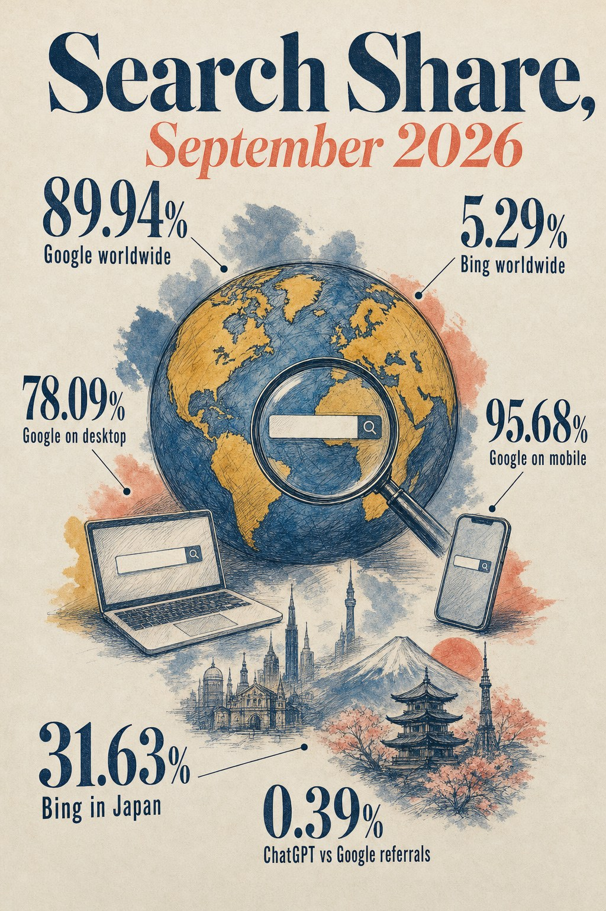

On December 13, 2025, a chart saying Google's share of search had dropped to 70% was posted to r/fivethirtyeight, and by November 19, 2026 that thread stood at about 60 upvotes and 20 comments. One of the top replies, at 20 upvotes, spotted the flaw straight away: the chart came from a survey asking people where they look for things, so nobody had counted actual searches. When searches and clicks are counted, [Statcounter](https://gs.statcounter.com/search-engine-market-share) still has Google near 90%, at 89.94% of worldwide search in September 2026 and 91.04% in October.

That single number hides most of the interesting parts. Bing is far stronger on desktop than most people assume, Google is not the leader in China or Russia, and it only just leads in South Korea. The team at [RankControl, an AI SEO and AEO platform](https://rctrl.com), where I work, exported Statcounter's data on October 19, 2026 for its post on [search engine market share](https://rctrl.com/blog/search-engine-market-share-2026), published October 24 and updated October 30. On November 19, 2026 I re-opened every source behind that post, pulled each number again and added October, so every figure below has a source and a month next to it.

The short version: all 112 figures I compared from the October post came back identical on November 19. Google held 89.94% of worldwide search in September and 91.04% in October, Bing had 5.29% and then 4.77%, and ChatGPT sat at 0.39% of the visits that Google and ChatGPT send to websites in September, then 0.08% in October.

## How we checked

**What I checked.** On November 19, 2026 I downloaded Statcounter Global Stats' monthly CSV exports for the worldwide market, the US, desktop and mobile, 12 countries, its Google vs ChatGPT series and its AI chatbot series. I re-read the Q3 2026 search referral page from Technology Checker, a website-technology lookup site that publishes Cloudflare Radar data, and I opened Cloudflare Radar's own list of search engine reports. I pulled Google search volume estimates for five names from DataForSEO, read the r/fivethirtyeight and r/SEO threads through an API, and re-opened Microsoft's April 29, 2026 earnings call page, Google's Search Console Help page and OpenAI's October 7, 2026 post.

**Sample.** From Statcounter's own pages. They claim that their data is derived from more than 3 billion monthly page views. Cloudflare Radar is measuring visits from search engines to the sites on the Cloudflare network. Google numbers are estimated monthly searches from US.

**Limits.** The web looks different in each network. None of these numbers are the market. On the front page of Statcounter they report Google 91.05% for October and Bing 4.8%. In the CSV I export the same afternoon, 91.04% and 4.77%. So I go by the CSV. I consider differences of a few hundredths rounding or timing differences. I couldn't repeat Cloudflare Radar's API. Cloudflare's Radar web pages don't let you download things. The Cloudflare Radar report list stops at 2025 Q4. So the Q3 2026 numbers for Radar are Technology Checker's October 1 2026 grab. The Statcounter web pages don't address what is going on in October below. I don't know if the October differences below are long term from one month of data.

## Search engine market share at a glance

| Statistic | Figure | Source | October 2026 (pulled November 19) |
|---|---|---|---|
| Google, worldwide | 89.94% | Statcounter, September 2026 | 91.04% |
| Bing, worldwide | 5.29% | Statcounter, September 2026 | 4.77% |
| Google, US | 85.19% | Statcounter, September 2026 | 85.45% |
| Bing, US | 9.91% | Statcounter, September 2026 | 9.76% |
| Google, worldwide desktop | 78.09% | Statcounter, September 2026 | 77.93% |
| Google, worldwide mobile | 95.68% | Statcounter, September 2026 | 96.31% |
| Google's share of search referrals | 89.04% | Cloudflare Radar, Q3 2026, via Technology Checker | No newer quarter published |
| ChatGPT vs Google, share of referrals | 0.39% | Statcounter, September 2026 | 0.08% |
| Bing monthly active users | 1 billion | Microsoft, April 2026 | No newer figure on Microsoft's July 29, 2026 call |

Between the two pulls, the September numbers didn't change at all. So far as I looked. That is across 112 numbers I checked. Worldwide 6 engines over 3 years, US numbers, desktop/mobile, 12 countries. The little engines. The Google vs ChatGPT/AI chatbot breaks. The 20 numbers on Technology Checker's page. And 5 numbers on Google search volume.

Still 90.91% for Google worldwide for April 2024. Still February 2026 and 10.48% for Bing's high water mark US. Still Technology Checker page updated on October 1, 2026.

3 things moved
Google global up 1.10 points between September and October (from 89.94% to 91.04%) now in the 91.02% to 91.32% range that was for June - August.
Brazil and India moved more than other major markets
ChatGPT faceoff and AI Chatbot split each advanced more in 1 month than in any month of the series I pulled (from April 2025)

1 thing didn't reverse
Google global desktop down from 78.09% in September to 77.93% in October
Bing global desktop up from 14.65% in September to 15.00% in October.

*Statcounter's September 2026 figures, re-pulled on November 19, 2026. The 0.39% is Statcounter's Google vs ChatGPT series.*

## Worldwide search engine share

With the monthly stats from Statcounter you can see the big engines over 3 years.

| Engine | September 2023 | September 2025 | September 2026 | October 2026 |
|---|---|---|---|---|
| Google | 91.58% | 90.38% | 89.94% | 91.04% |
| Bing | 3.01% | 4.10% | 5.29% | 4.77% |
| Yahoo | 1.24% | 1.46% | 1.36% | 1.18% |
| Yandex | 1.81% | 1.65% | 1.31% | 1.17% |
| DuckDuckGo | 0.58% | 0.87% | 0.74% | 0.64% |
| Baidu | 1.00% | 0.76% | 0.44% | 0.42% |

Google's Statcounter figure went from 91.58% in September 2023 to 89.94% in September 2026, down by 1.64 points. Bing from 3.01% to 5.29%, up by 2.28 points. Yandex down by 0.50 (1.81% to 1.31%), Baidu down by 0.56 (1.00% to 0.44%). Yahoo and DuckDuckGo didn't change much (1.24% to 1.36% / 0.58% to 0.74%). So most of the Google drop went to Bing and the rest is not significant.

Month by month in 2026, Google ranged from 89.85% in March to 91.32% in July, and Bing from 4.43% in January to 5.29% in September. September was Bing's best month of the year so far and one of Google's three lowest, and October's 4.77% for Bing sits just above its June to August range of 4.46% to 4.68%. A 1.10-point swing for Google in one month is the kind of move the section on noisy monthly numbers below deals with.

Statcounter measures page views on sites using their tracking code and notes down which search engine the user came from. Statcounter is the cited source, but it's only one network, so I wouldn't worry about the second decimal place too much.

## The US over two years

RankControl's post says most of its readers sell to US buyers, and the US doesn't follow the worldwide trend.

| Engine | September 2024 | September 2025 | September 2026 | October 2026 |
|---|---|---|---|---|
| Google | 87.99% | 85.02% | 85.19% | 85.45% |
| Bing | 7.03% | 8.50% | 9.91% | 9.76% |

Google lost 2.80 points in the US over two years (87.99% to 85.19%), more than the 1.64 points it lost worldwide over three, and Bing gained 2.88 (7.03% to 9.91%), so Bing took all of it. Bing's US share peaked in February 2026 at 10.48%, its highest in the Statcounter data I downloaded for September 2024 to October 2026. It then ran 9.85% in March, 9.82% in April, 9.43% in May, 8.73% in June, 8.63% in July and 8.99% in August, before returning to 9.91% in September and 9.76% in October.

## Desktop and mobile tell different stories

The global number is a combination of two different markets.

| Engine | Desktop, September 2026 | Desktop, October 2026 | Mobile, September 2026 | Mobile, October 2026 |
|---|---|---|---|---|
| Google | 78.09% | 77.93% | 95.68% | 96.31% |
| Bing | 14.65% | 15.00% | 0.69% | 0.61% |
| Yahoo | 3.35% | 3.32% | 0.45% | 0.36% |
| Yandex | 1.51% | 1.51% | 1.22% | 1.04% |

On mobile, Google is almost a monopoly - 95.68% on global mobile search in September, 96.31% in October. It is Yandex that's second on global mobile (1.22%, then 1.04%) - not Bing (0.69% then 0.61%). On desktop Bing still resides (14.65% in September, 15.00% in October, nearly 1 in 7 searches) - thanks to Windows, Edge and that Bing box on the Start menu.

The desktop series carries a bigger story than the all-devices one. In August 2026 Statcounter had Google at 85.94% of worldwide desktop searches and Bing at 8.91%; in September it had 78.09% and 14.65%, a 7.85-point drop for Google in one month, and in October 77.93% and 15.00%. From September 2025 to August 2026, Bing's worldwide desktop share stayed between 8.84% and 10.71%, so September was a step up that October did not undo. I found no explanation on Statcounter's pages.

The divide in the US is even larger. For example, in September 2026 Bing had 18.83% of desktop searches in the US vs. 18.81% in October (vs. 2.15% and 2.27% on mobile). Google had 74.70% and 74.82% of desktop searches in the US. The RankControl post makes the very practical point that a B2B site - where the buyers are at their desks - will have a much higher percentage of search traffic from Bing than a consumer site will.

## Search engine market share by country

Google's dominant in almost everything. The variance is huge from country to country. First 4 columns are Statcounter's numbers for September 2026. 12 large markets. Last column is October. That's my November 19 pull.

| Country | #1 engine | #2 engine | Bing | October 2026 |
|---|---|---|---|---|
| United States | Google 85.19% | Bing 9.91% | 9.91% | Google 85.45%, Bing 9.76% |
| Canada | Google 85.28% | Bing 10.08% | 10.08% | Google 85.04%, Bing 10.44% |
| United Kingdom | Google 91.35% | Bing 6.12% | 6.12% | Google 90.62%, Bing 6.72% |
| Germany | Google 87.84% | Bing 6.50% | 6.50% | Google 88.46%, Bing 6.39% |
| France | Google 88.14% | Bing 5.49% | 5.49% | Google 89.31%, Bing 5.13% |
| Australia | Google 87.87% | Bing 9.19% | 9.19% | Google 87.69%, Bing 9.32% |
| Brazil | Google 88.42% | Bing 9.63% | 9.63% | Google 92.01%, Bing 6.64% |
| India | Google 96.69% | Bing 1.89% | 1.89% | Google 98.06%, Bing 1.11% |
| Japan | Google 59.08% | Bing 31.63% | 31.63% | Google 59.58%, Bing 32.26% |
| South Korea | Google 47.97% | Naver 43.05% | 4.84% | Google 48.64%, Naver 42.10%, Bing 4.92% |
| China | Baidu 46.85% | Bing 21.61% | 21.61% | Baidu 49.08%, Bing 21.66% |
| Russia | Yandex 70.35% | Google 28.10% | 0.75% | Yandex 70.15%, Google 28.43%, Bing 0.82% |

Japan is the one I'd point to first. Bing had 31.63% of searches there in September 2026 and 32.26% in October, almost a third, which makes it Bing's strongest big country by far. In South Korea, Naver (43.05%) runs Google (47.97%) close, though the gap widened from 4.92 points in September to 6.54 in October.

In China and Russia, local engines are king. For example, 46.85% for Baidu in September and 49.08% in October in China. 21.61% and 21.66% for Bing in second place. According to RankControl's post, Google is banned there. But Statcounter shows Google getting 1.45% in September and 6.95% in October.

Yandex getting 70.35% and way down Google getting 28.10% in Russia. Then in October, 28.43%.

The biggest changes in two months were in Brazil where Google grew from 88.42% to 92.01% while Bing shrank from 9.63% to 6.64%. Then India where Google increased from 96.69% to 98.06% while Bing dropped from 1.89% to 1.11%. Yandex dropped in China from 15.01% to 11.58% while Baidu climbed by 2.23 points. All 9 other markets were within 1.2 points for the leading engine.

Because Google has 1.45% to 59.08% of market share in Japan, Korea, China and Russia, you're missing a big chunk of the market if you just plan on Google, as RankControl says in their post. Because you have to deal with webmaster tools and ranking idiosyncrasies for Naver, Yandex, Baidu...

## The smaller engines

Outside Google and Bing, no engine gets more than a few percent in any big market, but a handful are worth knowing. These are Statcounter's September 2026 figures.

| Engine | US | UK | Germany | France |
|---|---|---|---|---|
| Yahoo | 2.63% | 1.32% | 1.70% | 2.75% |
| DuckDuckGo | 1.75% | 0.66% | 1.07% | 0.84% |
| Ecosia | 0.12% | 0.30% | 1.03% | 1.34% |
| Qwant | Under 0.1% | Under 0.1% | 0.05% | 0.86% |

DuckDuckGo does best in the US, at 1.75% in both September and October, which is about one search in 57. Ecosia, the engine that plants trees with its ad revenue, is strongest in Germany (1.03%, then 0.92% in October) and France (1.34%, then 1.22%). Qwant is French and barely shows up anywhere else: 0.86% in France in September and 0.76% in October, against 0.05% in Germany.

Interest in DuckDuckGo is creeping up while Yahoo's is falling. These are US Google search volume estimates for the two names, from DataForSEO's Google keyword data.

| Search on Google (US) | September 2025 | September 2026 | October 2026 |
|---|---|---|---|
| "duckduckgo" | About 6.1 million a month | 7.5 million a month | 7.5 million a month |
| "yahoo" | 30.4 million a month | 24.9 million a month | 24.9 million a month |

The September 2025 column is the October post's figure, because the 12-month window I could pull starts in November 2025 (when "duckduckgo" read 6.12 million and "yahoo" 30.4 million). Google reports these volumes in steps: the DuckDuckGo figure read 6.12 million for nine straight months, from November 2025 to July 2026, before stepping to 7.48 million in August.

Well, the interesting thing for site-owners is that many of these search engines use Bing for at least part of their results. I read on November 19 that DuckDuckGo basically gets its links and images from Bing (DuckDuckGo help page). The post by RankControl implies that Yahoo and Ecosia also use Bing results too. So if your site is in Bing, you can check off a few of them.

## A second measure: Cloudflare Radar

Well, you don't need to believe Statcounter. Cloudflare has a very large portion of the web's traffic and the Radar service shows you what search engines bring traffic to their site (network). Technology Checker collected that data on October 1st 2026 and shared what they collected. They still showed "Updated Oct 1, 2026" on the page (19th of November).

| Referrer | Q3 2025 | Q2 2026 | Q3 2026 |
|---|---|---|---|
| Google | 81.10% | 87.90% | 89.04% |
| Bing | 2.61% | 3.36% | 3.22% |
| TikTok | 10.89% | 3.11% | 2.17% |
| Yandex | 1.59% | 2.06% | 1.62% |
| DuckDuckGo | 1.09% | 1.36% | 1.44% |
| ChatGPT | 0.21% | 0.28% | 0.64% |

Google's share of referrals rose from 81.10% to 89.04% in a year, mostly because TikTok's fell from 10.89% to 2.17%, and Technology Checker found that drop was concentrated in shopping sites. Bing also looks smaller here than in Statcounter's data, at 3.22% against 5.29%. Technology Checker offers two explanations it cannot tell apart: Bing's users click through to this slice of the web less often, or Statcounter's panel leans toward Bing. Each network sees its own slice of the web, so I'd treat neither as "the" number.

Technology Checker also split the data by the kind of site getting the visits, which shows TikTok's fall was a shopping story. Its share of referrals to shopping sites went from 23.49% in the first quarter of 2026 to 5.64% in the third. In computers and electronics, claude.ai sent 3.67% of referrals in the third quarter, more than DuckDuckGo or TikTok sent to those sites. AI referrals are small overall, but they aren't small everywhere.

Google's best month in the 2026 series (here on this page) is September (90.51%). For Technology Checker, September and the entire quarter are marked as preliminary (see below in noisy monthly numbers section for why). November 19th opened the latest Cloudflare's search engine referral list of reports (Radar). The latest in there is 2025 Q4.

## AI crawlers take far more than they send back

From Cloudflare's data they also provide the number of pages retrieved by a company's spiders during a visit (returned to them). For the third quarter of 2026 these were the ratios as reported by Technology Checker. (The second quarter ratios are shown as well.)

| Company | Pages crawled per visit referred, Q2 2026 | Pages crawled per visit referred, Q3 2026 |
|---|---|---|
| Google | 5.0 | 4.9 |
| Microsoft | 33 | 37 |
| OpenAI | 870 | 309 |
| Anthropic | 5,143 | 988 |
| Perplexity | 153 | 1,083 |

Google sends about one visit for every five pages it crawls (4.9 in the third quarter). The AI companies crawl hundreds of pages for each visit: 309 for OpenAI, 988 for Anthropic and 1,083 for Perplexity, with Microsoft at 37. The order inside the AI group changed in one quarter, since Anthropic's ratio fell from 5,143 to 988 while Perplexity's rose from 153 to 1,083. According to RankControl's post, that gap explains why so many publishers block AI crawlers, and why a mention in an AI answer doesn't bring traffic the way a Google ranking does.

## How AI engines compare with Google

Are AI engines taking search away from Google? That's what most people really want to know. Statcounter tracks Google and ChatGPT head to head, as a share of the visits the two send to websites. In September 2026 ChatGPT had 0.39% worldwide and 0.19% in the US, and back in April 2025 it was at 0.22% worldwide. From April 2025 to September 2026 the monthly worldwide figure stayed between 0.22% and 0.41%, so that share barely moved in well over a year. Cloudflare's data agrees, with ChatGPT at 0.64% of search referrals in the third quarter of 2026, up from 0.21% a year earlier.

For October it fell below that range, by Statcounter global number for ChatGPT was down to 0.08% and US to 0.03% (down from 0.19%). Lowest from the series that I downloaded. Technology Checker's Cloudflare monthly shows ChatGPT at 0.913% of referrals for July 2026, 0.531% August, 0.392% September. So decline over a few months is not new, but decline to 0.08% in one month is beyond what Statcounter showed for 18 months before that.

In terms of the AI engines themselves, ChatGPT is far ahead. Here's how referral data is broken down in September 2026 by AI chatbot, according to Statcounter: And October looks very different:

| AI engine | Share of AI chatbot referrals, September 2026 | October 2026 |
|---|---|---|
| ChatGPT | 80.47% | 51.03% |
| Gemini | 10.94% | 29.22% |
| Perplexity | 5.84% | 15.22% |
| Microsoft Copilot | 1.78% | 2.17% |
| Claude | 0.95% | 2.32% |

From April 2025 to September 2026 ChatGPT's monthly share ranged from 76.85% to 84.21%, Gemini's from 1.95% to 10.94% and Perplexity's from 4.34% to 12.07%. A drop of 29.44 points for ChatGPT in one month is far outside that, and Statcounter's headline panel for October reads slightly differently again (ChatGPT 51.58%, Gemini 28.86%, Perplexity 15.04%). Statcounter has not published November, so whether the October split lasts is not yet known.

What I find funny in the data is that people still go through Google to reach the AI engines. US Google searches for "chatgpt" ran at about 124 million a month in September 2026 and again in October, per DataForSEO's Google search volume estimates. The other two names grew fast over the past year.

| Search on Google (US) | A year earlier | September 2026 | October 2026 |
|---|---|---|---|
| "gemini" | 16.6 million a month | 30.4 million a month | 30.4 million a month |
| "claude" | 1 million a month | 9.14 million a month | 9.14 million a month |

The "year earlier" column is the October post's figure; in the window I could pull, "gemini" read 13.6 million in November 2025 and "claude" 1.22 million. Google is still the front door to its own rivals.

So why does it feel like AI is replacing search? Because people really do use it a lot. OpenAI's post of October 7, 2026, which I re-read on November 19, says more than 1.2 billion people use ChatGPT each week, a higher figure than the "more than a billion" the October post used, even though OpenAI's post is dated earlier. Most of what they ask gets answered right there in the chat, though, without a click to any website, so usage and referral traffic are two different things.

Google is also a beneficiary of some of that change, because of AI Overviews and AI Mode, which answer a lot of questions right on the results page.  You can search on Google without ever clicking somewhere else.  It doesn't appear as lost market share, but some sites will think they are losing clicks.  On their [Search Console Help page](https://support.google.com/webmasters/answer/16984139), Google says that on August 31, 2026 they have fully rolled out the generative AI performance report to all websites around the world, and it includes the AI Overviews and AI Mode impressions.  RankControl's post calls this the easiest way to see what percentage of a site's Google presence is now in AI answers.

## Bing's billion users, and the doubts

Microsoft said on its [April 29, 2026 earnings call](https://www.microsoft.com/en-us/investor/events/fy-2026/earnings-fy-2026-q3) that Bing's monthly active users had reached 1 billion for the first time, and in the same passage that monthly active Windows devices had passed 1.6 billion. The July 29, 2026 call, which I also read, gave no newer Bing user count. For an engine with about 5% of searches (5.29% in September on Statcounter, 4.77% in October) that's a big claim, and plenty of people didn't buy it.

The r/SEO thread titled "Bing Confirms 1 Billion Monthly Users Are Human, Not Agents" was posted on May 6, 2026 and showed 79 upvotes and 39 comments on November 19. Its top reply, at 65 upvotes, joked that they had only ever used Bing by accident. Another, at 25 upvotes, said Windows itself probably drives much of it, since typing into the Start menu can bring up Bing results. I think both are fair. A monthly user count includes anyone who touched Bing once, while market share measures how much each engine actually gets used.

It's not just bing.com. According to the RankControl post, Bing results are used at least in part by DuckDuckGo, Yahoo and Ecosia. And the web pages are found by Bing for Microsoft's Copilot. So your presence in Bing is important beyond the 5%.

## What this means for your website

Google is still the majority (89.94% of world-wide search and 85.19% of the US search) of your search traffic in September. RankControl's post doesn't change anything for English language sites in 2026. It just expands the market to include some other minor jobs around it.

Bing is worth an hour of setup. With 18.81% of US desktop searches in October 2026, it matters most if your buyers use work computers, and RankControl's post advises submitting your sitemap through Bing Webmaster Tools. AI engines are a small but growing source of visits: ChatGPT sent 0.64% of Cloudflare's search referrals in the third quarter of 2026, up from 0.21%. Today they matter more for getting your name into answers than for clicks, so track both.

Local engines matter in a few big markets. Plan for Bing if you sell in Japan (31.63% in September) and for Naver in South Korea (43.05%), and remember that Baidu (46.85%) and Yandex (70.35%) lead in China and Russia. Each one has its own webmaster tools, its own ranking signals and its own rules on what it will index. Your own analytics matter more than any of these figures, because your audience may look nothing like the worldwide average.

## Why the monthly numbers jump around

Monthly market share figures are very noisy. You need to know how noisy before you jump at a headline. With Statcounter the market share numbers depend on which sites have Statcounter tracking code and how much traffic they get for that month. That means one site that's big can come or go and that can shift the numbers in a country. For example Statcounter had the global numbers for April 2024 showing Google at 86.99%, down from what they've had for the last several months. In that article on Search Engine Land they were wondering if it was true that Google was losing share to Bing. The report on Search Engine Roundtable (May 6, 2024) was that Statcounter corrected a reporting bug. Google market share in the US for April went from 77.52% to 86.58% and Bing went from 13.05% to 8.24%.

RankControl's post exported worldwide April 2024 month again and checked it out in October 2026. And looks like Statcounter shows 90.91%. The November 19 I checked it is 90.91% world, US 86.58% + 8.24%. So they kept revised. They even revise history.

The October post had the same problem in its own US data. Here is Bing's share of US desktop searches across 2026, with the months I added from the November 19 pull.

| Month (2026) | Bing, US desktop |
|---|---|
| January | 16.42% |
| February | 16.66% |
| March | 14.20% |
| April | 13.73% |
| May | 12.72% |
| June | 11.65% |
| July | 12.08% |
| August | 12.94% |
| September | 18.83% |
| October | 18.81% |

Bing's US desktop share slid from 16.66% in February to 11.65% in June, then jumped 5.89 points between August (12.94%) and September (18.83%) and held at 18.81% in October. On the Cloudflare side, Technology Checker's page says Cloudflare reclassified part of its human and bot traffic in September, which is why it marks its September figures, and the quarter they sit in, as provisional.

So look at three-month or yearly trends, never at single months. The 1.10-point move in Google's worldwide share from September to October is the sort of swing that is usually noise, while the desktop step has now lasted two months and I wouldn't call it noise yet.

## How to read search market share figures

Start by clarifying: what are you counting?
Statcounter is counting pageviews, Cloudflare Radar counts referrals.
Microsoft's 1 billion is counting monthly users.
Chart in r/fivethirtyeight thread counts answers in a survey.
So those are different results for "market share".

Then check desktop and mobile separately, and look at the country. A blended 89.94% hides Bing's 14.65% desktop share, and a worldwide number says little about Japan (Google 59.08%), South Korea (47.97%), China (Baidu 46.85%) or Russia (Yandex 70.35%).

Be careful with surveys. They measure what people say they do, not what they do, and they tend to make new tools look bigger than they are.

Finally. Look out for changes. Past months are updated in Statcounter, as we saw in the April 2024 case. A number someone mentioned a year ago could look different according to the data in Statcounter now. Try to note when you got any number; I noted my numbers were gotten on November 19, 2026.

## How much this takes to track by hand

Watching search share for your markets takes about an hour a month, according to RankControl's post. You export Statcounter's data for each country you sell in, split by desktop and mobile, and compare it with your own analytics, then add another hour each quarter to check Bing Webmaster Tools and your AI referrals. That tells you which engines your buyers use. It won't tell you whether AI engines name you when those buyers ask about your category, and checking that by hand takes two to four hours a month for 20 questions.

RankControl's AI traffic analytics shows [GPTBot, PerplexityBot and ClaudeBot visits and AI referrals per assistant](https://rctrl.com/analytics), which is the site-level counterpart to the Cloudflare crawl and referral tables above.
