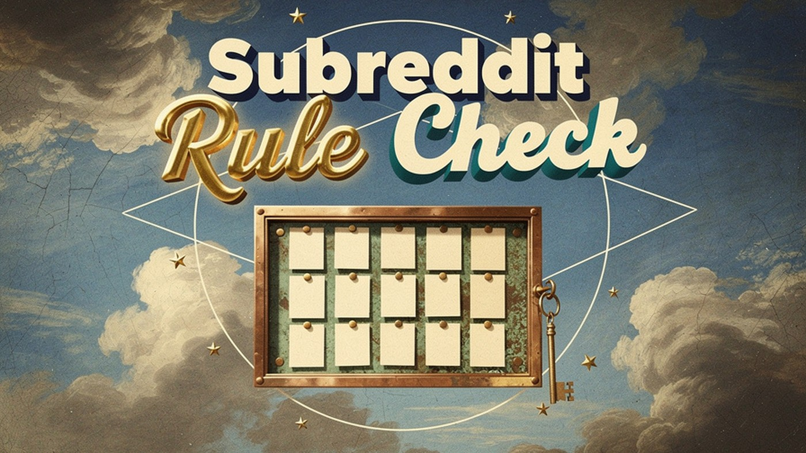
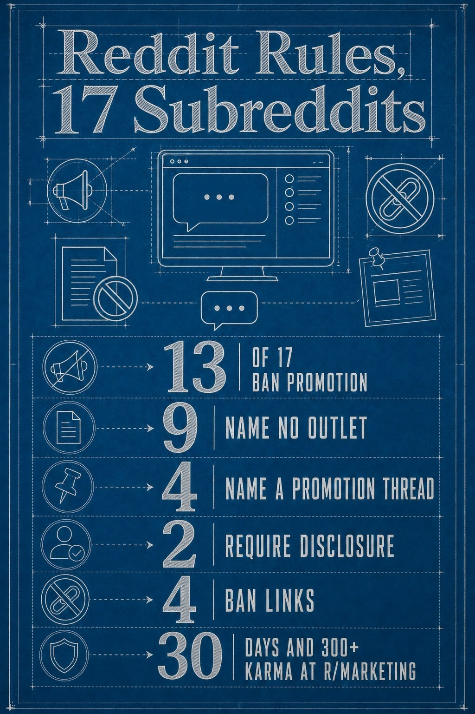

I extracted posted rules on 11/23/2026 for 17 subreddits where marketers, founders, agencies and sellers can hang out to discuss. Each of the 17 subreddits had a rule regarding spam/promotion/advertising. 13 had rules where they mentioned not allowing self-promotion or advertising in the rules and of those, 9 don't specify anywhere you can promote as a company.

I work at [RankControl, an AI SEO and AEO platform](https://rctrl.com), where SEO means search engine optimization and AEO means answer engine optimization, which is getting pages quoted in AI answers. RankControl's [October 24 playbook on Reddit marketing without getting banned](https://rctrl.com/blog/reddit-marketing) read 17 subreddits on October 19, among them r/webdev, r/DIY and r/personalfinance. This post starts from a marketing-focused list instead, and every rule and count below was pulled on November 23.

The cost of guessing shows in one founder's write-up. On August 1, 2026 [a poster in r/SaaS](https://www.reddit.com/r/SaaS/comments/1vcm3g5/i_marketed_my_product_with_nothing_but_reddit_for/) described a week of marketing with nothing but Reddit: 10 posts across 7 subreddits, 3 of them removed, including one in r/indiehackers. Those posts brought about 60,000 views, 80 site visitors, 7 signups and no revenue, and the poster's own reading was that posts about the product died while posts that gave real value did well.

Below. This is how I checked, with all 17 subreddits, quoting promotion rules, 9 other counts from the promotion rules, playbook within rules.

## How we checked

**What I checked.** I looked at 17 subreddits by calling AgntData's reddit API (paid for reddit data) twice for each (Nov 23, 2026, to get the rules that are posted and for the sub reddit's details), and all 34 calls get an HTTP 200 and the subreddit exists and is public. For each rule, I looked at the name and the description. I manually sorted each based on the rule name as a point of evidence. I saved the raw response.

**When.** All rules, numbers and amounts are as of Nov 23, 2026. Because mods update rules. Look at creation dates that reddit keeps: 22 out of 117 rules have 2026 creation date. All 9 rules in r/socialmedia have November 6 or Nov 10 as a creation date, meaning its rulebook is 2 weeks old or something.

**Sample.** 17 subreddits, 117 rules, from 4,790 (r/LawFirmMarketing) to 5,312,773 members (r/Entrepreneur). Selected locations where people ask questions about marketing, seo, ai-search, founder, small business, ecommerce and law firm marketing, plus r/aeo & r/GEO_optimization as we write about AI-search.

**Limits.** Text of rules only: no sidebars, no pinned threads, no AutoMod settings (can take down posts with no visible rule), no wiki pages (r/LawFirmMarketing: all promotion policy goes to wiki page which I can't access). Count is my interpretation of rules. Specific cases are labelled when applicable. Also, one day's pull doesn't say anything about how tight mods are on any rule for any mod team.

## The 17 subreddits and what their rules leave open

All the subreddits are categorized in 3 tables based on what's permitted by the promotion rule. (Rule names quoted as in Reddit. Members = number of subscribers as of November 23, 2026) Karma is the score that Reddit calculates based on the upvotes on user's posts and comments. Flair is the label given to a post.

### Nine ban it and name no outlet

| Subreddit | Members | Promotion rule, by name | What the rules leave open |
|---|---|---|---|
| r/socialmedia | 2,125,433 | "Spam/advertising or click bait"; "Self-promotion" | Sharing what worked "with no link and no pitch", or naming a tool you use when asked; for-hire posts go in a weekly job megathread |
| r/marketing | 1,984,997 | "Advertising, Self-Promotion, & Spam (Permanent Ban)" | Nothing; posting also needs an account over 30 days old with 300+ combined karma |
| r/ecommerce | 690,901 | "No Soliciting, Promotion, or Direct Soliciting via DM" | Nothing; "No External Links (Except Site Reviews)" |
| r/SEO | 523,001 | "No Spamming"; "No Links Allowed" | Nothing; any post or comment with a link is removed automatically |
| r/digital_marketing | 383,741 | "Advertising"; "Blog/Article/Video Link" | Nothing for offering services; link submissions to blogs, articles or videos are not allowed |
| r/PPC | 291,779 | "Spam" | Nothing for threads of services or tools by agencies, freelancers or contractors |
| r/content_marketing | 207,014 | "Spam"; "Self-promotion and offers" | Nothing; "NO self advertisement or any DIRECT advertisement allowed" |
| r/LawFirm | 110,635 | "Spam or self-promotion" | Nothing; "Do not post your blog or article" |
| r/TechSEO | 62,990 | "Don't be a shill" | Not for promotion-only posts; members who work at companies are welcome to say what they are up to |

### Four ban it except in one thread or a reply

| Subreddit | Members | Promotion rule, by name | What the rules leave open |
|---|---|---|---|
| r/Entrepreneur | 5,312,773 | "No promotion, sales, or solicitation" | "Free offers and promotions belong only in the designated weekly threads" |
| r/smallbusiness | 2,570,360 | "No business promotion posts" | The weekly Promote-your-business thread, or a mention in a relevant reply |
| r/startups | 2,154,576 | "No direct sales, advertisements, or promotion" | The Monthly Share Your Startup thread |
| r/LawFirmMarketing | 4,790 | "No Spam or Self Promotion"; "Disclose your affiliation" | The monthly pinned thread, or a mention inside a substantive answer with the connection disclosed |

### Four allow it with limits

| Subreddit | Members | Promotion rule, by name | What the rules leave open |
|---|---|---|---|
| r/SaaS | 851,069 | "No Vendor Spam on posts or comments" | Occasional promotion: max 1 mention or 3 links every 60 days, with the affiliation disclosed |
| r/indiehackers | 202,503 | "Self Promotion" | 1 time per user, with the Self Promotion flair |
| r/aeo | 11,447 | "No spam or aggressive self-promotion"; "Clarify promotional intent" | Recommendations welcome, no repeated self-promotion; ask the moderators first if unsure |
| r/GEO_optimization | 11,144 | "No blatant self-promotion"; "Self posts only" | A self post with a single link back to your own post |

Well, size correlates with the lane. The 5 subreddits with 1 million+ members break down to 2 no outlet (r/socialmedia, r/marketing) and 3 one designated thread (r/Entrepreneur, r/smallbusiness, r/startups). None allow a company to promote with limits. 
Of the 3 under 12,000 members, r/LawFirmMarketing, r/aeo, r/GEO_optimization, they all leave you some lane. It's a small sample of 1 day 17 subreddits, but i would see this as a check for a pattern, not a rule.

## What the counts say

**Promotion.** 13 of the 17 ban advertising/self-promotion explicitly in their rule text. 9 with no available outlet and 4 pointing to one thread/reply. The other 4 (r/SaaS, r/indiehackers, r/aeo, r/GEO_optimization) permit it, but with restrictions. 2 of the 13 are more specific than the others. r/digital_marketing's "Advertising" rule says the sub "is not for offering services or looking for a job". And "Spam" in r/PPC specifically calls out "a thread of services or tools by agencies, freelancers, contractors". 
 I counted those as advertising bans as well. r/socialmedia redirects threads of you offering services to get hired into their weekly job megathread, which I classified as a job thread (not a promotion).

**Outlets.** Four subreddits specifically point you to a thread or reply where you can promote: Monthly Share Your Startup thread for r/startups, r/Entrepreneur has specific designated weekly threads, r/smallbusiness has weekly Promote-your-business thread, r/LawFirmMarketing has monthly pinned thread. r/smallbusiness and r/LawFirmMarketing give you another avenue: the mention within a pertinent reply or good answer. r/smallbusiness also states that they've been removing mentions of products in new posts/comments "if they appear directly or indirectly promotional" since June 2026.

**Disclosure.** Two rules for disclosure. Per r/SaaS, you "Must clearly disclose affiliation at the beginning or end of the post or comment". And for r/LawFirmMarketing the wording for "Disclose your affiliation" is "I run X, so I am biased". It applies to everyone "mod team included". Secondaries pushing same product count towards the 1 mention / 3 links per 60 days limit for r/SaaS. Violating this "leads to a ban and URL blacklisting".

**Account gates.** Two rule sets name one. r/marketing says posts and comments from accounts that are not over 30 days old with 300+ combined karma "will be automatically removed", and r/Entrepreneur says you "must participate in the comments of other posts on this subreddit before posting yourself", with no number.

**Links.** There's four subreddits that explicitly forbid links in their rules: r/SEO ("Any posts or comments with links are automatically removed"), r/ecommerce ("No External Links (Except Site Reviews)"), r/smallbusiness ("No links, product recommendations, unsolicited advice, blog content, or SEO shaping.") and r/Entrepreneur ("No dropping URLs"). Three restrict blog/article links: r/digital_marketing, r/LawFirm and r/startups (requiring prior mod approval if it's a link to your blog post). Three forbid URL shorteners: r/marketing, r/SaaS and r/PPC.

**The 10% rule.** No rule of the 117 mentions a posting ratio, old "10% rule" or 9:1 split. However, people still mention it. Look at this October 1 2026 thread r/gamedev: How to promote and not get banned? The top comment (>100 upvotes on November 23) is "Less than 10% of your posts (not comments) should be promotional" and someone mentions "the 10% self-promotion bit". It's not in the rules, it's a habit among some people.

**Three more counts.** 5 that prohibit posting or commenting as AI generated. "AI Generated Content (Permanent Ban)" in r/marketing. "No AI Generated Posts" in r/digital_marketing. "Original and human content only" in r/Entrepreneur. "No AI or Suspected AI Slop" in r/ecommerce. and "No Low-Effort / Low-Quality Content" in r/SaaS (AI generated text is one of the kinds of content not allowed). 10 that limit the asking of surveys or market research the "pain points" post. r/marketing, r/SaaS (must be approved), r/startups (feedback thread), r/smallbusiness, r/LawFirmMarketing, r/LawFirm, r/digital_marketing, r/socialmedia, r/PPC and r/ecommerce. 7 that mention DM requests. r/SEO, r/startups, r/Entrepreneur, r/LawFirmMarketing, r/ecommerce, r/socialmedia, and r/SaaS.

*Counts from the rules of 17 subreddits, pulled on November 23, 2026.*

## One founder's week of Reddit marketing

On 11/23 read this r/Saas post (about 80 upvotes, 125 comments) from 8/1/2026. 
 10 total posts from this user to 7 different subreddits. 3 of which were removed. (2 from r/opensource and 1 from r/indiehackers). User reports all three were posts about product with no discussion/value to community. Other 7 posts: 338 views on one and about 36,000 views on another.

So the poster summed up the pattern with "the posts where I talked about my product? Dead". and when sorting by views it was the value-add posts that were the highest followed by the product posts.

Total about 60,000 views (across all 10) with 80 site visits 7 sign ups and 0 paid conversions. (aka about 1 site visit for every 750 views)

Poster was planning on doing a rerun by sticking to 2 or 3 subreddits and never directly pitch the product.

Also there's the line "a karma score of more than 90 will get you past the gates of most subreddits" in the write-up. And, they have 237 karma to start. r/marketing has a rule of 300+ combined karma plus 30 days for the line, so a 237 karma account wouldn't be able to pass. And they thought that the posts would continue to drive traffic for months from google (which is not being tested here).

## The rule above all of them

Reddit has its own [sitewide rules](https://redditinc.com/policies/reddit-rules), that overrides all subreddits' rulebooks. And Rule 2 is the one that applies to marketers: "Abide by community rules. Participate authentically in communities where you have a personal interest, and do not spam or engage in disruptive behaviors (including content manipulation) that interfere with Reddit communities."

Effective June 5, 2025, Reddit's [Moderator Code of Conduct](https://redditinc.com/policies/moderator-code-of-conduct) states moderators are "expected to uphold the Reddit Rules by setting community rules, norms, and expectations that abide by our site policies". So on any given day, you'll get 17 different answers from 17 different subreddits because that's the sitewide rule; obey each community's rules. (These rules are defined by the moderators, as each team has a different one.) I visited both of them on November 23, 2026.

## Reddit marketing without the ban: a playbook from the rules

This is the RankControl playbook. It's been updated with numbers above.  It links each step with its rule.

**Step 1: go where buyers ask, then read that subreddit's rules.** All the ones that let you promote were the ones that other sellers found first. In that r/gamedev thread in October 1 there's a reply with over 20 upvotes that's basically saying you're trying to sell cars in a car dealer convention when you promote there. Your buyers are in the sub where they ask about the problem you solve. So it's not r/SaaS as much as it's trades and freelancer communities for your invoicing solution. And then there are 3 questions in the rules that you need to answer. Can I promote? Where can I promote? Do I get to have links?

**Step 2: warm up the account.** Give it a couple weeks (2-4) of normal use without product mention or link. Just comment where you can and let them know what has worked for you. Ask good questions for follow up as well. Those gates up there are legit. 30 days 300+karma total in r/marketing... and r/Entrepreneur requires comments before a post.

A response in the r/gamedev thread clarified it further,  posts  "get removed when they feel like an ad and they get left up when they feel like content".  There is no rule out of 117 that says no link to self in profile.  But r/Entrepreneur has a rule against telling people to look in your profile.

**Step 3: answer the question, then disclose in one line.** Eventually someone asks you for what you do specifically. Answer them, even if they don't end up using your product. Answer it in full and helpfully. Then just say it once. It's yours. "I run a small invoicing app, so I'm biased, but for rental businesses the thing to look for is saved item lists you can turn into quotes" works.

No link, no sales pitch, no "DM me". 
It follows r/LawFirmMarketing example ("I run X, so I am biased") and also r/SaaS rule (disclose beginning/end). 
r/SaaS also clarifies that "naked" links/product descriptions are considered spam.

**Step 4: use the outlet that exists.** If there's an allocated space, use it (monthly share your startup in r/startups, weekly threads in r/smallbusiness & r/Entrepreneur, monthly pinned thread in r/LawFirmMarketing etc). It's not as exposed as the front page but it's where you get written into the rules to do promotional posts. 1 mention/3 links every 60 days in r/SaaS, so budget for it as an allocated slot. r/GEO_optimization you can post something that's natively written for the sub and may have 1 link back to the source for instance.

**Step 5: write every word yourself.**  5 of the 17 rule sets prohibit AI generated posts or comments.  r/marketing is outright ban forever.  r/digital_marketing will remove the post and ban you.  Find a thread to do research on or fact check it however you want.  But type out the response like you'd respond to a colleague that asked you.  I'd apply the same idea to subreddits with no rules for the same thing.  Regs notice the tone.

**What gets accounts banned fast.** If you line up rule pages they all list the same offenses: DM soliciting (7 of 17). Url shorteners (3), market research posts (10), copy/pasted or repetitive posts (listed in "Spam/advertising or click bait" on r/socialmedia) and having a second account to promote the same thing (r/SaaS counts alternate accounts as part of the limit).

## What to expect from Reddit marketing

Reddit is a bad place to make quick sales. r/SaaS founder's week finished 80 visits, 7 signups, $0 out of roughly 60,000 views. You get (maybe) the pay-off in search/AI answers further down the line. On 11/17/2026 we asked the same 270 keywords to the ChatGPT app and Google AI Mode. Google AI Mode cited reddit threads for 70 of the 270 answers (80 citations) ChatGPT cited reddit for 2 (7 citations). A response that's still useful months later has a better shot at being found than one that's good for the day.

## What this costs in hours

The guess from RankControl is 4-6 hours per week. 1-2 hours searching for threads; about 1 hour to read the rules and context; 2-3 hours to make 4-5 helpful replies. Same weekly time investment for 2-4 weeks before even getting a mention (i.e. the warm-up).

RankControl's Backlinks feature [finds backlink prospects for every article and drafts the outreach](https://rctrl.com/backlinks). In it, the social threads step finds Reddit and X threads where a published article answers the question, reads the subreddit's rules before you post and drafts a reply, and while an account is new its warm-up mode keeps the drafts free of brand mentions.

There are limitations:  Backlinks page said on November 23, 2026 that it is only Reddit and X.  October playbook says nothing is posted on its own, so you have to review each and post it yourself. No draft can make a rule like r/SEO's "No Links Allowed" allow a link.
