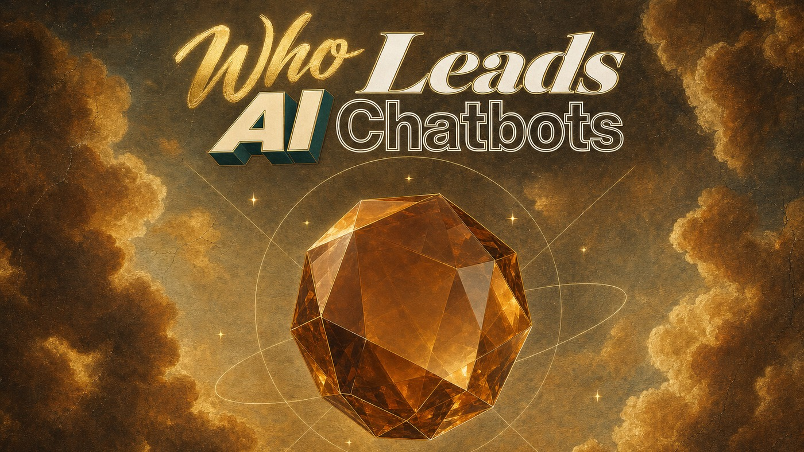

Which AI chatbot deserves your effort depends on what you want from it, and six sources I re-read on November 26, 2026 rank the leaders differently. ChatGPT leads four of the six measures below, Anthropic leads the two that count US businesses, Gemini is second on every consumer count, and Perplexity sends far more clicks to websites than its share of visits would predict. Whether your goal is traffic to your site, visibility inside answers or reach among business buyers, the engine to work on changes with it.

The split showed up inside a single month. In October 2026, [Statcounter](https://gs.statcounter.com/ai-chatbot-market-share) had ChatGPT at 51.03% of the clicks that AI chatbots sent to websites, Similarweb had it at 55.7% of visits to chatbot sites, and [Ramp's AI Index](https://ramp.com/data/ai-index) found 44.8% of US businesses on its platform paying Anthropic against 40.6% paying OpenAI. Statcounter's ChatGPT line read 80.47% for September, and before that 29.44-point fall no month since April 2025 had moved it by more than 4.42 points.

[RankControl, an AI SEO and AEO platform](https://rctrl.com), ran [an article on this question](https://rctrl.com/blog/ai-chatbot-market-share-2026) on October 20, 2026 and updated it on October 30, using Statcounter data it pulled on October 19 and Similarweb figures through May. On November 26, 2026 I went back to each source behind that article, read the numbers again and added October. Each figure that follows names its source and month. Charts of LLM market share usually pick one yardstick and treat it as the whole market, which is the habit this post takes apart.

## LLM market share at a glance: six measures

Different things are counted in different rows. And the leader changes when the row changes.

| Measure | Source and month | ChatGPT | Gemini | Claude | Perplexity | Grok |
|---|---|---|---|---|---|---|
| Clicks sent on to websites | Statcounter, October 2026 | 51.03% | 29.22% | 2.32% | 15.22% | Not tracked |
| Share of visits to chatbot sites | Similarweb, October 2026 | 55.7% | 24.2% | 11.5% | 0.8% | 2.2% |
| Share of AI assistant users | Sensor Tower via TechCrunch, May 2026 | 46.4% | 27.7% | 10.3% | Under 5% | Under 5% |
| US adults who ever use it | Pew, February 2026 survey | 44% | 24% | 6% | Not asked | 8% |
| US businesses paying the vendor | Ramp, October 2026 | 40.6% (OpenAI) | Not in Ramp's table | 44.8% (Anthropic) | Not in Ramp's table | 6.3% (xAI) |
| Share of business token spend | Ramp, week ending November 15, 2026 | 37.2% (OpenAI) | 1.4% (Google) | 58.7% (Anthropic) | Not in Ramp's table | 2.4% (xAI) |

So ChatGPT runs 44% to 55.7% across the four consumer rows.

Claude and Anthropic goes from 2.32% of referrals to 58.7% of token spend (the most range in table).

Perplexity is from 0.8% visits to 15.22% referrals.

*Six leaders under six measures, each from its own source and month (see the table above).*

## How I checked

**What I checked.** For Statcounter I pulled the monthly CSV files behind its worldwide AI chatbot chart on November 26, 2026 (all devices, desktop, mobile and tablet, September 2025 to October 2026, plus all devices from April 2025), and I read the chart's headline panel and the site's FAQ. For Similarweb I read its monthly "Gen AI website traffic share update" posts on X, from June 11 to November 10, 2026, and its blog article of July 29, 2026. I also opened the June 16 press release for Sensor Tower's State of AI report, its blog summary, its Q2 2026 market index, TechCrunch's report on the study, Pew Research Center's June 17 report, Ramp's AI Index page, The Decoder's write-up of Ramp's September edition, Alphabet's Q3 2026 earnings remarks of October 28, OpenAI's November 10 announcement and TechCrunch's June 5, 2025 report on Perplexity's query count. I read the r/artificial thread through SociaVault's Reddit API.

**Sample.** Statcounter's referral counts come from websites that have installed its tracker, and its FAQ keeps a 45-day window from first publication for revisions, so October stays open until about mid-December. Similarweb's shares are visits to chatbot websites worldwide. Pew's fieldwork ran February 17 through February 23, 2026 and reached 5,119 US adults. Ramp's index covers more than 85,000 US businesses that pay through its corporate card and bill-pay platform, and its token figures cover the businesses that use its AI Spend Management product.

**Limits.** Sensor Tower's full report sits behind a form, so I could not open it, and the 46.4% and its companions come from TechCrunch's reading of the report's charts. Sensor Tower's own press release says ChatGPT's "True Audience" share, which counts unique users across mobile app and web, fell below 50% for the first time in March 2026, while TechCrunch says ChatGPT held over 50% until January and had it at 46.4% by the end of May, and I could not reconcile the two. Similarweb revises earlier months by a tenth or two between posts (its July figure for ChatGPT reads 54.8% in the August 11 post and 54.3% in the October 12 post), and Statcounter's headline panel shows 51.58% for ChatGPT in October against 51.03% in the CSV, so I use the CSV throughout.

**Gaps.** I could not get my download of The Next Web's description of the Similarweb 2026 report that was the source of the US app growth percentages in the October post, so I left them out. No source I looked into is good for Chinese assistants. No primary source number for how much use of Grok is in X.

**What changed since October 20.** The September Statcounter figures in the October post reproduced in the CSV (the October post prints ChatGPT as 80.48% in some places and 80.47% in others, and the CSV says 80.47%), and so did all 15 of its desktop, mobile and tablet figures. Pew's, Sensor Tower's and Similarweb's May numbers are unchanged. What moved is everything dated October or later: Statcounter's referral split, Similarweb's visit shares, Ramp's adoption and its new token-spend table, and Alphabet's first count of one billion Gemini app users.

## Referrals: what chatbots send to websites

Statcounter tallies the visits that AI chatbots send to sites running its tracker and splits them by chatbot. The ChatGPT share fell from 80.47% in September 2026 to 51.03% in October, the biggest one-month move in a series that starts in April 2025 (the next biggest ChatGPT move is 4.42 points, in May 2025). Statcounter's AI chatbot page carries no note about the change as of November 26, and from these figures alone I cannot say whether people's behavior changed or the way referrals are recorded did.

| Chatbot | September 2025 | September 2026 | October 2026 |
|---|---|---|---|
| ChatGPT | 81.12% | 80.47% | 51.03% |
| Gemini | 2.82% | 10.94% | 29.22% |
| Perplexity | 10.85% | 5.84% | 15.22% |
| Microsoft Copilot | 4.04% | 1.78% | 2.17% |
| Claude | 0.99% | 0.95% | 2.32% |
| DeepSeek | 0.18% | 0.02% | 0.05% |

Statcounter, worldwide, each chatbot's share of all AI chatbot referrals, monthly CSV pulled November 26, 2026.

The October post described Gemini rising from 2.82% to 10.94% over a year while Perplexity lost about half its share, from 10.85% to 5.84%. By October Gemini reached 29.22% and Perplexity 15.22%, so Perplexity's loss reversed too. Gemini first passed Perplexity in the series in March 2026 (8.65% against 7.07%), fell behind again in May (7.04% against 7.67%) and has led since June.

This is the device split where the October move occurred.

| Chatbot | Desktop, Sept | Desktop, Oct | Mobile, Sept | Mobile, Oct | Tablet, Sept | Tablet, Oct |
|---|---|---|---|---|---|---|
| ChatGPT | 80.01% | 46.76% | 83.72% | 69.66% | 75.58% | 73.89% |
| Gemini | 11.25% | 31.90% | 8.82% | 17.47% | 13.57% | 16.14% |
| Perplexity | 5.67% | 15.88% | 6.87% | 12.45% | 9.54% | 9.48% |
| Microsoft Copilot | 2.00% | 2.62% | 0.33% | 0.17% | 0.79% | 0.12% |
| Claude | 1.05% | 2.79% | 0.24% | 0.24% | 0.52% | 0.37% |

Statcounter, September and October 2026, referral shares split by device, worldwide, monthly CSVs pulled November 26, 2026.

ChatGPT lost 33.25 points on desktop (80.01% to 46.76%), 14.06 on mobile (83.72% to 69.66%) and 1.69 on tablet (75.58% to 73.89%), so the October change sits mostly on desktop. ChatGPT's mobile share had stayed between 82.06% and 86.14% every month from September 2025 to September 2026. Copilot's desktop share was six times its mobile share in September (2.00% against 0.33%), a pattern RankControl's post ties to Copilot being built into Windows and Office, and Claude's was about four times (1.05% against 0.24%). In October those ratios were about 15 times for Copilot (2.62% against 0.17%) and about 12 times for Claude (2.79% against 0.24%).

RankControl points out how a lot of B2B sites are desktop-heavy. In the desktop columns (which is what you are seeing if you're a site that is desktop-heavy like this) for October, ChatGPT is at 46.76%, Gemini is at 31.90%, and Perplexity at 15.88%. That's what you are seeing, not the worldwide numbers.

## Visits: where people go

Similarweb is tracking the other way around (visits to chatbot sites, not clicks from them).  On November 10, 2026 they reported ChatGPT was 55.7% of the visits in October, Gemini was 24.2% and Claude was 11.5% (91.4% total), then Deepseek 3.4%, Grok 2.2%, Copilot 1.1%, Perplexity 0.8%.  So the advantage for ChatGPT over Gemini is 31.5 points (versus 21.81 points for Statcounter Oct referrals).

| Month | ChatGPT | Gemini | Claude | DeepSeek | Grok | Perplexity |
|---|---|---|---|---|---|---|
| June 2025 | 76.4% | 8.9% | 1.6% | 5.3% | 2.8% | 1.8% |
| November 2025 | 69.5% | 15.9% | 2.1% | 4.1% | 3.3% | 2.2% |
| December 2025 | 65.2% | 20.3% | 2.0% | 3.8% | 3.8% | 2.1% |
| March 2026 | 56.7% | 25.5% | 6.0% | 3.7% | 3.4% | 1.6% |
| April 2026 | 53.7% | 26.7% | 8.0% | 4.0% | 3.2% | 1.5% |
| May 2026 | 52.7% | 27.3% | 8.9% | 4.0% | 2.8% | 1.3% |
| August 2026 | 55.6% | 25.6% | 9.3% | 3.5% | 2.5% | 0.9% |
| September 2026 | 56.4% | 25.0% | 9.6% | 3.4% | 2.3% | 0.9% |
| October 2026 | 55.7% | 24.2% | 11.5% | 3.4% | 2.2% | 0.8% |

Similarweb: share of visits to generative AI sites worldwide. From the monthly Similarweb posts on X. Similarweb calls its columns "1, 3, 6 and 12 months ago" (wrt the date of the post). In its November 10 post Similarweb names months. I used May 2026/ March 2026/ December 2025/ June 2025 for June 11 post columns. Used March 2026 for the column "1 month ago" for April 16 post.

The October post set the theme for the year as ChatGPT drop from 76.4% to 52.7%. Subsequent posts by Similarweb indicate a halt in the drop. May and June each reported ChatGPT at 52.7%. July was 54.3%, August was 55.6%. Sept was up to 56.4% peak. Then October at 55.7%. Gemini peaked June at 27.8%. In October was at 24.2%. Claude has been rising from 8.9% in May to 9.6% in September to 11.5% in October. More than five times November 2025 at 2.1%. Top three were 88.9% visits in May. In October they were at 91.4%.

Shares describe a growing total. Similarweb's own article of July 29, 2026 counts average monthly visits to generative AI websites at 9.5 billion for June 2025 to May 2026, up 70% on the year, with unique visitors up 57% to 655 million and app downloads up 58% to 4.4 billion. Its authors add that ChatGPT's absolute visit count stayed roughly flat while the category grew, so a flat leader looks like a declining one.

## Users and installs: apps and company counts

June 16, 2026. Sensor Tower released a "State of AI 2026" report. As summarized by TechCrunch, by the end of May, ChatGPT's market share in AI assistant users was 46.4%, while Gemini's was 27.7%, Claude's was 10.3%, and Grok, Perplexity, DeepSeek and Meta AI were all below 5%. Behind those shares, ChatGPT had over 1.1 billion monthly users, Gemini had 662 million, and Claude had 245 million. According to a press release from Sensor Tower, ChatGPT, DeepSeek and Gemini occupied almost 90% of the time spent in AI assistant apps in the first quarter of 2026.

Per-user time. Share is not the same. If you read the Sensor Tower blog summary, it shows ~215 minutes/user/month for ChatGPT, 100 for Gemini and 120 for Claude. (No month indicated.) So Claude's users spend more time/user than Gemini (with Gemini's userbase more than double).

Companies count users their own way. Alphabet's CEO said on October 28, 2026 that the Gemini app is now at one billion users, without saying whether that is a weekly or monthly count. OpenAI's announcement of November 10, 2026 says ChatGPT reaches 1.2 billion people a week. Sensor Tower's 662 million for Gemini is a monthly figure for May, so none of the three lines up with another.

Installs are the hardest measure to compare. Similarweb's article gives app downloads across all generative AI apps (up 58% to 4.4 billion), and Sensor Tower's Q2 2026 index says ChatGPT passed 2 billion cumulative downloads and earned $1.4 billion in quarterly revenue, up 82% on the year, while Claude's revenue rose fourfold on the first quarter. Neither page splits downloads by chatbot, so I have no share to put in the table. Queries are no easier. Perplexity's CEO said it received 780 million queries in May 2025 (TechCrunch, June 5, 2025), and I found no newer count from the company that I could read.

On May 9, 2026 a user in r/artificial asked whether Google's market share in LLMs is real, and on November 26 the post had a score of 2 and 37 comments. The most upvoted of the 16 comments the API returned, at 15, argued that Gemini beats ChatGPT at story brainstorming. A reply with 4 upvotes said much of Google's AI adoption looks distribution-driven, because people use Gemini as it comes bundled into products they already rely on. Similarweb's July article says the same thing in its own words, that Gemini is "riding distribution it already owns (Search, Android, Workspace)".

## US adults: who has tried what

[Pew Research Center](https://www.pewresearch.org/internet/2026/06/17/americans-and-ai-2026-chatbots-smart-devices-and-views-on-impact/) released survey results on June 17, 2026. Surveyed 5119 adults in the US between February 17-23. Asked which AI chatbots they have used. ChatGPT: 44%. Gemini: 24%. Copilot: 17%. Meta AI: 14%. Grok: 8%. Claude: 6%. Character.ai: 3%. Pew chart does not include Perplexity and DeepSeek. Adults younger than 50 had about double rate of use of ChatGPT as adults 50+. (57% vs 28%).

Since Pew is not counting frequency and is only counting "ever use" and also their field work is 8 months older than Statcounters October results, you can easily show Grok at 8% vs Claude 6% by including anyone who ever used the chatbot (what Pew does). Whereas Similarweb Oct visits puts Claude at 11.5% and Grok at 2.2%.

## US businesses: adoption and token spend

Ramp's AI Index reads corporate card, invoice and bank-transfer payments from more than 85,000 US businesses and counts a business as an AI adopter when it has a positive payment for an AI product in the month. For October 2026, Ramp reports 56.8% of US businesses on its platform paying for some AI product. Anthropic was paid by 44.8% (43.7% in September), OpenAI by 40.6% (unchanged at 40.6%), xAI by 6.3% (up from 4.1%), and DeepSeek and Mistral AI by 0.2% each. The sectors with the highest adoption were information (80.1%), finance and insurance (74.3%) and professional, scientific and technical services (70.8%).

Ramp also publishes the total token spend for companies using their AI Spend Management product (which pulls in usage from connected providers, both API spend (paid directly to them) and via cloud platforms/routers). For the week ending November 15, 2026, Anthropic captured 58.7% of that token spend (56.9% the week ending October 18), OpenAI 37.2% (38.5%), xAI 2.4% and Google 1.4%. Token volume Anthropic had 59.4% and OpenAI 37.7%. Blended price (for OpenAI and Anthropic combined) per million tokens came in at $0.45 (was $0.51). OpenAI at $0.38, Anthropic $0.50.

The Decoder article for Ramp's September edition gives the August numbers the October post used. Anthropic was at 43.8% of US businesses (up 0.34), OpenAI 39.8% (up 0.09). So OpenAI's up 0.8 from that August number (Sept data from Ramp) and Anthropic down 0.1. Also in that report, the effective price/million tokens is down 41% from March 2026 peak to $0.68. Also, tokens for frontier models are down from 53% (early Aug) to 45% (early Sept) and 6.4% of AI-using companies on Ramp are using open weight models.

A few points: Ramp's numbers are not the same as the consumer numbers. Their adoption is about having any payment. Not spending. They also note that it's likely their numbers are an underestimate of AI usage since you can use free tools or a personal account and not have any paid transaction. October's median AI spending per employee was $16.32. For the top 1%, it was $10,199.20. AI accounts for 5.43% of business spend (not including payroll).

## Which chatbots send their users out

Dividing Statcounter's referral share by Similarweb's visit share for the same month gives a rough index of how often a chatbot's users click through to websites compared with the attention it gets. A ratio above 1 means more clicks than visits would predict. I calculated these ratios myself, and the two sources count different populations, so treat them as a guide.

| Chatbot | Referrals, Sept | Visits, Sept | Ratio, Sept | Referrals, Oct | Visits, Oct | Ratio, Oct |
|---|---|---|---|---|---|---|
| Perplexity | 5.84% | 0.9% | 6.5 | 15.22% | 0.8% | 19.0 |
| Microsoft Copilot | 1.78% | 1.5% | 1.2 | 2.17% | 1.1% | 2.0 |
| ChatGPT | 80.47% | 56.4% | 1.4 | 51.03% | 55.7% | 0.9 |
| Gemini | 10.94% | 25.0% | 0.4 | 29.22% | 24.2% | 1.2 |
| Claude | 0.95% | 9.6% | 0.1 | 2.32% | 11.5% | 0.2 |

Perplexity is far above 1 in both months and Claude well below it in both. ChatGPT and Gemini change places: in September ChatGPT sent 1.4 times its visit share and Gemini 0.4, and in October the figures were 0.9 and 1.2. The October post's version of this table mixed September referrals with May visits and had Perplexity at about 4.5, ChatGPT at 1.5, Gemini at 0.4 and Claude at 0.1. RankControl's post puts Perplexity's high ratio down to its design as an answer engine that shows its sources up front. Similarweb's article describes Claude's growth as coming from developers and power users, a smaller group that sticks around once it commits.

## The smaller ones: Grok, Perplexity and DeepSeek

Grok is most difficult to determine. Pew says 8% of adults in the US use it. Similarweb says it's 2.2% of October visits (3.3% in November 2025). Ramp says 6.3% of US businesses pay xAI (October, 4.1% in September). Sensor Tower says it's below 5% of users of AI assistants in May. Statcounter's AI chatbot data doesn't even have Grok on the list. A post from RankControl suspects that much of Grok's usage may be occurring within X (so can't be seen by website metrics) and I couldn't find a primary figure to test that out.

Perplexity's numbers point in more directions than any other chatbot's. According to Statcounter, in September 2025 its referral share was 10.85%, in September 2026 5.84%, and in October 2026 15.22%. According to Similarweb, the share in visits was 1.3% (May) and 0.8% (October). There is no mention of Perplexity in the adoption table from Pew and Ramp. The most recent corporate number that I could check is 780 million queries (May 2025).

DeepSeek shows how far apart the measures can sit. It had 3.4% of Similarweb's October visits, 0.05% of Statcounter's October referrals and 0.2% of US businesses paying on Ramp in October, and Sensor Tower names it with ChatGPT and Gemini among the three apps behind nearly 90% of time spent in the first quarter of 2026. Copilot and Meta AI sit between the extremes. Pew has Copilot at 17% and Meta AI at 14% of US adults, Similarweb has Copilot at 1.1% of visits, and Similarweb's article says Meta AI is distributed for free inside apps that billions of people already had open, and lists it with Claude as the fastest US app growers among platforms that barely register in web share.

## Where to spend effort, engine by engine

For traffic to your site, ChatGPT sent 51.03% of Statcounter's AI chatbot referrals in October and 80.47% in September, so it is the largest measurable source in both months, and your own referral report will show how much of Statcounter's October swing your site saw. Gemini is second on all four consumer measures, and its referral share rose about 2.7 times in a month (10.94% to 29.22%) while its share of visits slid from 27.8% in June to 24.2% in October.

Claude is the engine a referral line understates most. It had 2.32% of referrals in October against 11.5% of visits, 120 minutes per user in Sensor Tower's summary, and first place on both of Ramp's business measures (44.8% of US businesses and 58.7% of token spend). Its ratio of 0.2 in the table above means few of its users click out, so whether Claude mentions your brand has to be read from its answers. Perplexity is the reverse, with 15.22% of referrals from 0.8% of visits, and Grok has 2.2% of visits, 8% of US adults who have tried it and 6.3% of US businesses paying xAI.

RankControl's AI visibility tracker tracks [citations across 7 AI engines: ChatGPT, Perplexity, Claude, Gemini, Grok, Google AI Mode and Google AI Overviews](https://rctrl.com/ai-visibility). It checks the 50 questions you choose once a week and logs which engine, which question and which page it cited, so it reports what each engine says about your brand and not how many people use that engine, which is what the market sources above measure. The plan costs $400 a month, and the 7-day free trial that comes first needs a card at sign-up. RankControl's post estimates that checking 20 buyer questions across seven engines by hand means 140 answers a week, three and a half to five hours of reading and logging, plus about an hour to match them with AI-referred visits in analytics.

## Numbers to use, by purpose

| If you are writing about | Figure | Source |
|---|---|---|
| AI traffic to websites | ChatGPT 51.03% of AI chatbot referrals (80.47% in September) | Statcounter, October 2026 |
| Who people visit | ChatGPT 55.7% of visits to AI chatbot sites | Similarweb, October 2026 |
| App and web users | ChatGPT 46.4% of AI assistant users | Sensor Tower via TechCrunch, May 2026 |
| US awareness | 44% of US adults ever use ChatGPT | Pew, February 2026 survey |
| Business adoption | Anthropic 44.8% against OpenAI 40.6% of US businesses paying | Ramp, October 2026 |
| Business token spend | Anthropic 58.7% against OpenAI 37.2% | Ramp, week ending November 15, 2026 |

It's 44%, 46.4%, 51.03% or 55.7% (depending on how you look at it) and they're all right, so include the measure and the month alongside whichever one you're quoting.
