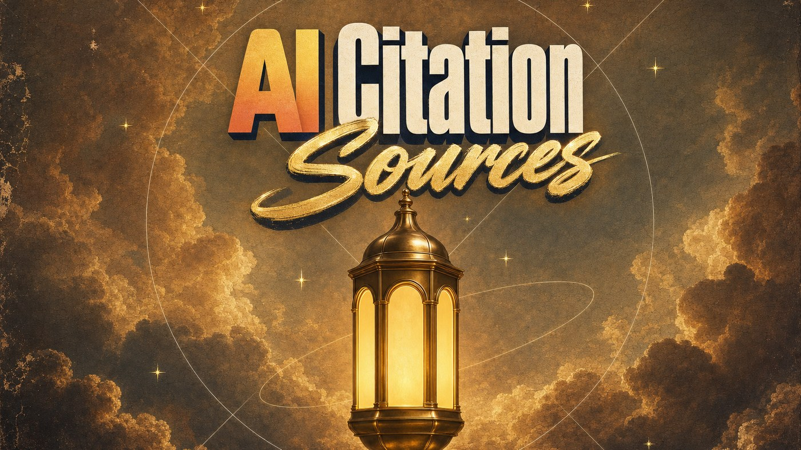

The platform to publish on depends on the AI engine you want to be cited by, and the lists published in November 2026 point in three directions. YouTube is the most-cited site in Google's AI Overviews, at 24.5% of the citations among that engine's top 50 sources. Reddit is first on Perplexity (24.6%) and Gemini (29.9%). Wikipedia is first on ChatGPT in Ahrefs' list (10.1%), although a second tracker puts Wikipedia at 0.03% of all ChatGPT citations in November, and company and product sites supplied 64.0% of the citations in one June sample of Claude.

A citation here means a source link an AI answer shows. [RankControl, an AI SEO and AEO platform](https://rctrl.com), published a [post on this question on November 17](https://rctrl.com/blog/how-ai-engines-cite-sources-reddit-youtube-wikipedia), working from Ahrefs' September lists. Ahrefs updated those lists on November 3, so on November 26, 2026 I re-read every figure at the page of the study that produced it, and several have moved. The rest of this post says what each number counts.

## How I checked

**What I checked.** Every figure comes from a study or list that someone else ran, except the 30-search check that appears in the Reddit, YouTube and Wikipedia sections, which is RankControl's data from September 27, 2026 and which I re-counted from the saved results. I ran no AI queries of my own. For each figure I opened the study's own page and looked for the number in its text. That covered Ahrefs' seven lists of the 50 most-cited websites per engine and its studies of ChatGPT's top 1,000 cited pages, of 75,000 brands and of 1.4 million ChatGPT prompts; Promptwatch's monthly citation pages and its August 18 and November 10 reports; OtterlyAI's studies of Claude and of the August Reddit drop; a Semrush study from November 10, 2025; Peec AI's March 31, 2026 study; a Wikimedia Foundation post from October 17, 2025; and two Reddit threads.

Ahrefs shows November numbers for their pages. I've looked at the September ChatGPT, Google AI Overviews, Google AI Mode lists as stored in the Internet Archive as of October 14 / September 28 / September 18.

**When.** All of this was read November 26, 2026. All the dates in the studies themselves are preserved as is in what follows. None of the stuff referenced postdates November 26.

**Sample.** The samples differ a great deal. Ahrefs' lists rest on over 3 million US queries for Google AI Overviews, Gemini and Copilot, over 3.1 million for Perplexity and over 1.9 million for Grok, while its ChatGPT and AI Mode pages say only "a broad sample of US queries". Promptwatch's November ChatGPT page uses a random one-in-eight sample of responses. OtterlyAI's Claude study counted 379,321 citations, Semrush's 2025 study covered 230,000 prompts, Peec AI's covered 30 million sources, and RankControl's check covered 30 searches. Prompt sets, countries and dates differ, so the sizes cannot be added up or set side by side.

**Limits.** Ahrefs, Promptwatch, OtterlyAI, Semrush and Peec AI each sell AI visibility or search tracking, and none of the studies is a controlled experiment. Ahrefs does not say which days its monthly list covers. The Internet Archive holds no copy of the Perplexity, Gemini or Copilot pages from between September 1 and November 3, so their September figures appear only as RankControl printed them and I could not check them. Grok's list has not been updated since June 2026. RankControl's check ran 30 searches on one day, all about business software.

## Where each platform ranks on each engine

Every month Ahrefs ranks the 50 websites each AI engine cites most, using its Brand Radar tracking of US queries, and reports each site's mention share: its citations as a percentage of the summed citations of those 50 sources. I added up the 50 shares on each of the seven lists and got between 99.9% and 100.3%, so a share below is a slice of a top-50 total and not a slice of everything the engine cites.

| Engine | Reddit | YouTube | Wikipedia |
|---|---|---|---|
| ChatGPT | 6.2%, 2nd | 2.3%, 8th | 10.1%, 1st |
| Google AI Overviews | 18.1%, 2nd | 24.5%, 1st | 4.4%, 7th |
| Google AI Mode | 18.1%, 2nd | 17.0%, 3rd | 5.9%, 5th |
| Perplexity | 24.6%, 1st | 14.2%, 2nd | 7.2%, 3rd |
| Gemini | 29.9%, 1st | 6.3%, 3rd | 8.6%, 2nd |
| Copilot | Not in the top 50 | 1.8%, 13th | 6.5%, 3rd |
| Grok (June 2026 list) | 16.3%, 1st | 15.1%, 2nd | 3.4%, 8th |

*Mention share and rank from Ahrefs' lists of the 50 most-cited websites per engine, United States, updated November 3, 2026 (Grok: June 2026), read on November 26, 2026. AI Overviews are the AI-written summaries above many Google results and AI Mode is Google's chat-style search.*

All three platforms are on every list except one: Reddit is missing from Copilot's top 50. YouTube's rank runs from first on AI Overviews to 13th on Copilot, and Wikipedia's from first on ChatGPT to eighth on Grok. Copilot's fourth-ranked site, at 4.5% and up 20% in citations, is grokipedia.com, another encyclopedia site, sitting just under Wikipedia's 6.5%.

Peec AI ranked the same platforms from a different sample. Its March 31, 2026 analysis of 30 million US sources across ChatGPT, AI Mode, Gemini, Perplexity and AI Overviews puts Reddit first, YouTube second, LinkedIn third and Wikipedia fourth across the five engines together, and it gives rank only, with no shares. Its per-engine top fives agree with Ahrefs on the leaders for AI Overviews (YouTube then Reddit), Perplexity (Reddit then YouTube) and ChatGPT (Wikipedia then Reddit). They differ on two points: Peec has YouTube second and Wikipedia third on Gemini where Ahrefs has the reverse, and Peec has YouTube ahead of Reddit on AI Mode where Ahrefs has Reddit ahead of YouTube, with google.com first. For how little the engines' cited domains overlap and how fast citations fade, see [Why AI Visibility Isn't One Number](https://rankcontrol.github.io/2026/11/ai-visibility-per-engine-citation-data/) on this site.

## What the September lists showed and how many pages sat behind the shares

RankControl's November 17 post used Ahrefs' September 2 update. The archived copies from September 18, September 28, October 3 and October 14 all still carry that September list, and the next update came on November 3. The table sets the "pages cited" column, which counts the distinct pages on a domain that an engine cited, next to the November one for the three engines whose September lists survive.

| Engine and site | September list: share, rank | November list: share, rank | Pages cited, September to November |
|---|---|---|---|
| ChatGPT, Reddit | 16.8%, 1st | 6.2%, 2nd | 810,887 to 172,760 |
| ChatGPT, Wikipedia | 7.0%, 2nd | 10.1%, 1st | 129,667 to 109,914 |
| ChatGPT, YouTube | 2.5%, 8th | 2.3%, 8th | 114,596 to 44,436 |
| AI Overviews, YouTube | 22.9%, 1st | 24.5%, 1st | 1,737,252 to 1,231,678 |
| AI Overviews, Reddit | 18.5%, 2nd | 18.1%, 2nd | 830,641 to 478,918 |
| AI Overviews, Wikipedia | 4.0%, 7th | 4.4%, 7th | 88,400 to 62,881 |
| AI Mode, Reddit | 17.9%, 1st | 18.1%, 2nd | 1,204,712 to 560,575 |
| AI Mode, YouTube | 17.8%, 2nd | 17.0%, 3rd | 1,553,020 to 839,853 |
| AI Mode, Wikipedia | 4.0%, 6th | 5.9%, 5th | 100,864 to 110,953 |

*Ahrefs' lists for September 2 data (Internet Archive copies from October 14, September 28 and September 18) and for the November 3 update (read November 26, 2026).*

The pages column fell on eight of the nine rows. The steepest drops were 78.7% for Reddit on ChatGPT and 61.2% for YouTube on ChatGPT, and Wikipedia gained pages only on AI Mode, up 10.0%. Ahrefs does not say whether the two lists cover the same number of days, so I read the drop as fewer distinct pages in the sample and not as proof that the engines stopped citing those sites. On ChatGPT the Reddit to YouTube ratio was 7.1 to 1 in pages and 6.7 to 1 in share in September, then 3.9 to 1 and 2.7 to 1 in November.

November 17 post from RankControl for three lists without archived September copy showed Reddit/YouTube/Wikipedia shares of 21.6%/20.8%/6.3% for Perplexity, 28.5%/14.6%/8.8% for Gemini, and (for Copilot) 1.9% (11th) on YouTube and 7.6% (3rd) on Wikipedia with nothing on Reddit. Comparing that to November table, that's higher on Wikipedia for Perplexity (7.2%) vs lower for Gemini (8.6%) and Copilot (6.5%) and lower on YouTube for Perplexity and Gemini and unchanged for Copilot (1.8%). But I couldn't read those September numbers at Ahrefs pages.

## ChatGPT month by month: Reddit up and then down, Wikipedia down

Promptwatch has a monthly page about the top sites ChatGPT cites (as a proportion of total citations that it picked up via the ChatGPT interface during web search). It's not top 50 citations, it's all of the citations as denominator. So low numbers. And it's all the pages combined as one measure of 2026.

| Window in 2026 | Reddit | Wikipedia | Promptwatch page dated |
|---|---|---|---|
| January 1 to 31 | 2.58% | 3.63% | February 3 |
| February | 2.96% | 3.80% | April 5 (in the March page) |
| March | 3.21% | 3.61% | April 5 |
| April | 4.14% | 1.15% | May 5 |
| May | 6.11% | 0.72% | June 5 |
| June 1 to 27 | 3.71% | 0.56% | June 28 |
| July 18 to August 7 | 3.83% | Not stated | August 18 |
| August 14 to 17 | 0.52% | Not stated | August 18 |
| October | 0.38% | Not stated | November 23 |
| November 1 to 22 | 0.24% | 0.03%, outside the top 20 | November 23 |

*Share of all ChatGPT citations recorded by Promptwatch from ChatGPT's interface when web search ran. Promptwatch's November page uses a random sample of one response in eight.*

Reddit's share rose in each month from January to May, when Promptwatch's page called it "peak Reddit" at 6.11%, more than eight times Wikipedia's 0.72%. It was 3.71% in June and 3.83% from July 18 to August 7, then 0.52% on August 14 to 17, an 86.4% relative drop that Promptwatch calls provisional because it cannot rule out a problem in its own data collection. By November 1 to 22 it was 0.24%, 36.8% below October's 0.38%. Wikipedia moved earlier: from 3.61% in March to 1.15% in April, a loss of 68.1% in a month, and to 0.03% by November.

The two sites fell together once before. Semrush's study, published November 10, 2025, tracked weekly citations for 230,000 prompts on ChatGPT search, Google AI Mode and Perplexity in 13 snapshots from July 14 to October 12, 2025, covering more than 100 million citations. It found ChatGPT citing Reddit in close to 60% of responses in early August 2025 and about 10% by mid-September, and citing Wikipedia in roughly 55% of responses before falling below 20%. Semrush counts responses that cite a site, which is why its figures run far larger than Promptwatch's. The page records a disagreement about the cause: some SEOs pointed to Google's removal of its num=100 search parameter around September 11, 2025, and Semrush's Sergei Rogulin did not think that was the root cause, or at least not the only one, and put the main reason down to ChatGPT trying to avoid over-citing certain websites.

OtterlyAI measured the 2026 drop in a post published August 27, 2026, using 16 brand reports from Netflix to the American Red Cross. Across the 16 reports, citations of reddit.com in ChatGPT averaged 497 a day before mid-August and 132 after, a fall of 73.4%, while ChatGPT's total citations rose from 36.1 thousand to 37.4 thousand a day (3.5%). Reddit's citations on Google, AI Mode, Gemini and Perplexity together went from 2,117 a day to 2,104, a change of 0.6%. All 16 reports lost ChatGPT citations to Reddit and three fell to zero.

## Reddit: strong on Perplexity and Gemini, rarely credited by ChatGPT

Ahrefs' April 15, 2026 study of 1.4 million ChatGPT 5.2 prompts (updated August 27; the page dates the sample "February 2025 (desktop)", which looks like a typo for 2026) found that ChatGPT cited about 50% of the URLs it retrieved. The rate depended on the retrieval channel: 88.46% of 25,563,589 data points from general search, 12.01% from news, 1.93% of 16,182,976 from a separate Reddit feed, 0.51% of 953,693 from YouTube and 0.40% from academic sources. Reddit made up 67.8% of the URLs that were retrieved and not cited. Ahrefs notes that a Reddit or YouTube page returned by ordinary web search is counted in the search channel, so the 1.93% describes the separate feed.

In a blog post published February 15, Promptwatch reports on what threads are cited in January 2026, on Reddit. For the Reddit posts cited by ChatGPT between January 1 to February 1, roughly 71% had less than 10 upvotes. Another 22% had between 10-50 upvotes. 0.6% of citations are posts with 500 or more upvotes. Around 55% of posts cited have less than 10 comments. Roughly 90% have less than 50. Threads with 250 or more comments account for 0.05% of citations. More than 6 months old 60% of posts cited. Over 2 years old, 22% of posts cited. Less than a month old, 11%.

On 27th September 2026, RankControl checked 30 searches for business software. Used DataForSEO for Google search results (provides search results for Google via API, US English desktop). Reddit was in the organic top 10 for 26 of the 30 queries. Provided 23 of the 203 sources (11.3%) with sources shown in AI Overviews (appeared in 20 out of the 27 AI Overviews with sources). Provided 24 out of 220 sources in AI Mode (10.9%) for 18 out of 28 answers. For both, the cited threads were in r/SaaS (7), r/DigitalMarketing (5), r/sysadmin (4), r/smallbusiness (4). 1-2 each from other subs.

When the drop reached r/technology on August 22, 2026, the thread "[Reddit fades from ChatGPT citations](https://www.reddit.com/r/technology/comments/1vv7itl/reddit_fades_from_chatgpt_citations/)" collected 3,046 upvotes and 413 comments by November 26. The top comment, at 2,899 upvotes, said Google kept giving it Reddit results instead of articles, and the reply "A Redditor is not a reputable source" had 318.

## YouTube: the Google engines' favorite, almost absent on ChatGPT and Claude

On Ahrefs' November lists YouTube is first on AI Overviews (24.5%), second on Perplexity (14.2%) and Grok (15.1%), third on AI Mode (17.0%) and Gemini (6.3%), eighth on ChatGPT (2.3%) and 13th on Copilot (1.8%). Ahrefs' "citation change" column, the change in the number of answers citing a site since the previous snapshot, shows YouTube up 62% on ChatGPT and down 46% on Gemini and 30% on Perplexity.

Promptwatch has 2 social media reports, they use the total citations of an engine as the denominator, so you can compare YouTube across engines and over time. February 28 2026 report was for Feb 1-28. The November 10 report was for October 11-Nov 9.

| Engine | YouTube, February | YouTube, October 11 to November 9 | Reddit, February | Reddit, October 11 to November 9 |
|---|---|---|---|---|
| Google AI Overviews | 2.25% | 6.71% | 1.65% | 2.10% |
| Perplexity | 2.74% | 0.31% | Not stated | 0.82% |
| ChatGPT | 0.05% | 0.03% | 2.96% | 0.40% |

*Share of all citations on each engine, from Promptwatch's reports of February 28 and November 10, 2026.*

On AI Overviews Promptwatch's own pages show YouTube at 2.32% in January and 4.16% from June 1 to 27, before the 6.71% above. In the November report YouTube alone was 6.71% of AI Overviews citations, more than the other six social platforms it tracked combined (6.45%).

Per RankControl's September 27 check, again, Google-leaning: YouTube was 56 of 203 (27.6%) sources for AI Overview (in 23 of 27 overviews) and 58 of 220 sources (26.4%) for AI Mode (21 of 28 answers). 9 of the 30 searches had YouTube in Google's organic top 10 results. So the pulling for YouTube was definitely much more pronounced for Google's AI answers than its normal results. For "asana vs monday" there were six YouTube videos out of the ten sources for AI Overview.

Ahrefs, in their December 12, 2025 research (updated on August 12, 2026) looking at 75,000 brands, found that the correlation is highest with YouTube brand mentions in video titles/transcripts/descriptions (Spearman correlation around 0.737, 1.0 is perfect up and down relationship between two metrics and 0 means no relationship at all), followed by branded web mentions (0.66 to 0.71), and finally domain rating (the 0-100 Ahrefs metric for strength of backlinks for a site) correlating 0.266 on ChatGPT, 0.285 on AI Mode, 0.326 on AI Overviews. The data sample was domains with domain rating greater than 40 and top keyword having at least 800 searches/month. Ahrefs says correlation doesn't imply causation.

Promptwatch's February 28 report also describes the videos that were cited. About 80% of citations went to videos with under 100,000 views, the 10,000 to 100,000 bucket was the largest at 36% of cited videos, and about 7% of cited videos had passed 1 million views. Of the cited videos, 78% had fewer than 1,000 likes, and about 80% of citations came from channels with under 100,000 subscribers.

## Wikipedia: first on one list, near zero on another

Wikipedia is on all seven of Ahrefs' lists, first on ChatGPT (10.1%), second on Gemini (8.6%), third on Perplexity (7.2%) and Copilot (6.5%), fifth on AI Mode (5.9%), seventh on AI Overviews (4.4%) and eighth on Grok (3.4%). Ahrefs' study of the 1,000 pages ChatGPT cited most in September 2025, published October 28, 2025 and updated August 12, 2026, found Wikipedia at 29.7% of those URLs, ahead of homepages and landing pages (23.8%), educational pages (19.4%) and Q&A, community and forum pages (0.9%). Ahrefs sorted the URLs into types with Claude and calls the result directional.

Other trackers give a smaller role. Promptwatch's June report has Wikipedia at 0.15% of AI Overviews citations, up from 0.10% in May, against 4.4% on Ahrefs' list, and its November page has 0.03% on ChatGPT. OtterlyAI's August 27 study found Wikipedia moving up instead: in its 16 brand reports encyclopedia and reference sources rose in 4 of the 5 reports where they appeared, and it says the widely shared Wikipedia decline traces to September 2025. In OtterlyAI's June sample of Claude, which covered SaaS and technology questions, encyclopedias supplied 2.1% of 379,321 citations across 142 domains, an average of 56 citations per domain.

As of 27th of September RankControl report: No Wikipedia contributions in 423 sources for AI Overviews and AI Mode answers. Top 10 ranking in Google for 1/30 search. According to RankControl Wikipedia responds to "what is" questions and for example when you're a potential buyer of CRM or Payroll system you get an answer composed of vendor pages, review sites, and some of YouTube and Reddit, too.

Fewer people open Wikipedia itself. On October 17, 2025 the [Wikimedia Foundation reported](https://wikimediafoundation.org/news/2025/10/17/new-user-trends-on-wikipedia/) that human pageviews were down roughly 8% on the same months of 2024, after it reclassified March to August 2025 traffic to remove bots built to look human, and it pointed to generative AI and social media. In an r/Teachers thread from August 23, 2026 (1,271 upvotes, 185 comments), a teacher argued that teachers should drop their dislike of Wikipedia because its summaries are sourced, which a chatbot's are not, and the top reply, at 735 upvotes, said to start with Wikipedia and then track down the primary sources.

Of the three platforms Wikipedia gives a brand the least control. Wikipedia's [conflict of interest guideline](https://en.wikipedia.org/wiki/Wikipedia:Conflict_of_interest) says editors with a conflict of interest (COI), including paid editors, are strongly discouraged from editing affected articles directly, which in RankControl's reading leaves coverage by independent sources as the route to a page.

## Claude and company sites

Claude's mix looks different from every Ahrefs list. OtterlyAI's study of June 2026, published June 30, tracked Claude daily on SaaS and technology prompts and sorted 379,321 citations from 16,406 domains into 11 categories. Company and product sites supplied 64.0% across 10,842 domains, news and media 14.9%, community and forum sites 1.3%, encyclopedias 2.1% and video 0.3% across 20 domains. Social media was 0.9% and Reddit was cited 0 times. The 50 most-cited domains held 26.8% of all citations and about 500 domains were needed to reach 59.9%.

For ChatGPT post August change OtterlyAI's 16 brand reports show the same direction: official brand and competitor pages are up for 10 of 15 reports, other commercial sites up for 9 of 15, news and media down for 11 of 12.

## Why the numbers disagree

The same platform gets very different numbers because each study divides by something different. Wikipedia on ChatGPT is the clearest case.

| What the number is a share of | Wikipedia on ChatGPT | Source |
|---|---|---|
| Citations among the top 50 sources | 10.1% | Ahrefs, November 3 update |
| All ChatGPT citations in a window | 3.63% in January, 0.03% from November 1 to 22 | Promptwatch |
| Responses that cite the site | About 55%, falling below 20% | Semrush, July to October 2025 |
| The 1,000 most-cited URLs | 29.7% | Ahrefs, September 2025 data |

Reddit on ChatGPT shows the same spread: 6.2% of the top-50 citations (Ahrefs), 0.24% of all citations from November 1 to 22 (Promptwatch), and 1.93% of the Reddit-feed URLs ChatGPT retrieved that it went on to cite (Ahrefs). A fourth denominator is the answer itself: YouTube appeared in 23 of the 27 AI Overviews that listed sources in RankControl's check, a count of answers and not of citations.

RankControl's November 17 post turned one of these into another. It took Reddit's 16.8% of ChatGPT's September top-50 citations and multiplied it by 26.8%, the share of all Claude citations that OtterlyAI found in Claude's top 50, to get roughly 4.5% of everything ChatGPT cites, and it labeled that rough. Promptwatch's January to June figures for Reddit, 2.58% to 6.11%, bracket 4.5%. But Promptwatch's 20 most-cited ChatGPT domains together held around a tenth of all citations in March and 4.37% in November 1 to 22, well under the 26.8% that estimate borrowed, so the match may be a coincidence.

*Figures from the studies above, read on November 26, 2026. The first three are shares of each engine's top-50 citations (Ahrefs, November 3 lists), 6.11% to 0.24% is Reddit's share of all ChatGPT citations in May and from November 1 to 22 (Promptwatch), 1.93% is Ahrefs' citation rate for the separate Reddit feed, and the last is OtterlyAI's June sample on SaaS and technology prompts.*

## What the numbers support on where to publish

| Platform | Cited most by | What the data says gets cited | Limits |
|---|---|---|---|
| YouTube | Google AI Overviews, AI Mode, Perplexity, Grok | Videos under 100,000 views took about 80% of cited-video citations; brand mentions in titles, transcripts and descriptions correlated at 0.737 | 0.03% of ChatGPT citations in Promptwatch's November report and 0.3% of Claude's; on Perplexity it fell from 2.74% to 0.31% |
| Reddit | Perplexity, Gemini, Google's AI features, Grok | About 71% of the Reddit posts ChatGPT cited had under 10 upvotes, and about 60% were over six months old | 0 of 379,321 Claude citations; not in Copilot's top 50; ChatGPT cited 1.93% of Reddit-feed URLs; its ChatGPT share went from 6.11% to 0.24% |
| Wikipedia | ChatGPT, Gemini, Copilot | Reference pages with sources; 29.7% of ChatGPT's 1,000 most-cited URLs | A company is strongly discouraged from editing its own article; none of 423 sources in RankControl's check; 0.03% in Promptwatch's November data |
| Your own site | Claude, and ChatGPT since August | Product, pricing and comparison pages: official brand pages rose in 10 of 15 OtterlyAI reports | The Claude sample covers SaaS and technology prompts only |

These are overall industry averages and not going to give you a sense for what engines cite in your category. That is something you are going to have to count on your own. It's not a lengthy process.

1. Pull 20 real buyer questions from your sales calls and demo notes.
2. Put each one to the engines your buyers use and note every domain that gets cited.
3. Work out what share of all citations goes to Reddit, YouTube, Wikipedia and your own site, so every number has the same denominator.
4. Repeat it every month. Promptwatch's ChatGPT figure for Reddit went from 6.11% in May to 3.71% in June.

RankControl's AI visibility tracker tracks [citations across 7 AI engines: ChatGPT, Perplexity, Claude, Gemini, Grok, Google AI Mode and Google AI Overviews](https://rctrl.com/ai-visibility). Its page says each of 50 tracked questions, which you can edit at any time, is checked every week on all seven, and it lists who the engines cite for your queries: you, your competitors, Reddit and YouTube, or editorial sites. Copilot is not one of the seven, so the Copilot rows above have no RankControl tracking behind them. The weekly check also cannot show the daily swings that Promptwatch plots, and the 50 questions are yours, so the result describes your category and not an industry-wide list like Ahrefs'.

According to the back of the envelope calculations RankControl does, it takes 16-24 hours to do 8 good articles per month manually, plus you can add roughly 6 hours per week of manually checking 50 questions across 7 engines. You can use a spreadsheet and your list of questions to do your own source mix counting. And the tracker will do the weekly checks for you.
